# VoiceGuard AI — Local Micro-Acoustic Voice Spoof & Deepfake Detection System

**VoiceGuard AI** is an offline, privacy-first forensic voice-authenticity detection platform designed to distinguish genuine human speech (**BONAFIDE**) from synthetic / AI-generated speech (**SPOOF** — neural TTS, voice conversion, vocoder artifacts, and replay attacks).

The complete pipeline executes strictly on local hardware (CPU/GPU) with zero cloud egress and zero persistent audio storage.

---

## 1. Project Highlights & Architecture

- **Acoustic Feature Extraction:** 60-band Linear Frequency Cepstral Coefficients (**LFCC**) computed via SciPy DCT-II over linearly spaced triangular filterbanks (`0–8,000 Hz`), capturing high-frequency vocoder artifacts over a `60 × 398` feature matrix (`4.0 s` / `64,000 samples` at `16,000 Hz`, frame length `400`, hop `160`, FFT `512`).
- **Deep Learning Classifier:** Lightweight 3-block Convolutional Neural Network (**`AudioCNN`**, `23,361` trainable parameters, `~95.5 KB` checkpoint) trained on ASVspoof 2019 Logical Access (`LA`) and speaker-weighted In-The-Wild (`ITW`) speech (`best_audio_cnn_itw_speaker_weighted.pth`).
- **Calibrated Decision Boundary:** Raw-logit threshold `0.15903853` (`raw_logit >= threshold` → `SPOOF`, else `BONAFIDE`) with `normalization_stats_22k.npz` Z-score normalization and startup SHA-256 integrity verification.
- **Multi-Mode Capture & Streaming:**
  - **Audio File Upload:** `.wav`, `.flac`, `.mp3`, `.ogg`, `.m4a`, `.aac`, `.wma`, `.webm` up to `25 MB`.
  - **In-Browser Studio Recording:** Lossless 16-bit mono 16 kHz PCM WAV encoding via Web Audio API (`wavEncoder.js`).
  - **Real-Time Live WebSocket Streaming (`/api/ws/live`):** `4.0 s` sliding window with `1.0 s` hop, energy-based Voice Activity Detector (`SpeechActivityGate`), and Exponential Moving Average (`EMA`) prediction smoothing so silence is never falsely flagged as `SPOOF`.
- **Persistence & Graceful Fallback:** Local MongoDB Community Server (`voiceguard_db.detection_history`) stores prediction telemetry only (never raw audio) with a `500 ms` failover timeout if MongoDB is offline.

```mermaid
flowchart LR
    Client["React + Vite Frontend (localhost:5173)"] -->|Upload / WAV / WebSocket PCM| API["FastAPI Backend (localhost:8000)"]
    API --> Pre["Decode -> Mono -> 16 kHz -> 64,000 Samples"]
    Pre --> LFCC["60-band SciPy DCT-II LFCC (60 x 398)"]
    LFCC --> Norm["Z-Score Norm (normalization_stats_22k.npz)"]
    Norm --> CNN["AudioCNN (23,361 params, SHA-256 verified)"]
    CNN --> Dec["Logit >= 0.1590 -> SPOOF / BONAFIDE"]
    Dec --> DB[("Local MongoDB (Metadata Only)")]
```



---

## 2. Model Verification & Evaluation Summary

- **Active Checkpoint:** `voiceguard_integration/models/best_audio_cnn_itw_speaker_weighted.pth` (`23,361` parameters)
- **Validation Balanced Accuracy (ASV dev2k + ITW):** `87.53%` at calibrated logit threshold `0.15903853` (per `audio_cnn_itw_speaker_weighted_metadata.json`).
- **External FoR (`for-2sec`) Evaluation Split (1,088 samples — 544 bonafide / 544 spoof):**
  - **Accuracy / Balanced Accuracy:** `94.12%` (`1,024 / 1,088` correct)
  - **ROC-AUC (raw logit):** `0.9790`
  - **Equal Error Rate (EER):** `6.80%` (`0.0680`)
  *(See `voiceguard_integration/integration_docs/LIMITATIONS.md` and `VOICEGUARD_AI_VIVA_DOSSIER.md` for full scope and limitations.)*

---

## 3. Repository Structure

| Path | Description |
| :--- | :--- |
| `backend/` | FastAPI server (`main.py`), in-memory `AudioService`, `ModelLoader` (SHA-256 verified), `InferenceService`, `LiveAudioSession`, MongoDB repository/routes, and `backend/tests/` (52 automated pytest cases). |
| `frontend/` | Active React 18 + Vite 6 + Tailwind CSS UI (Upload, Studio Recorder, Live WebSocket Detection, History Dashboard, Model Specs modal). |
| `voiceguard_integration/` | Portable inference package (`voiceguard/`), authoritative model weights/stats/metadata (`models/`), integration docs (`integration_docs/`), and readiness reports (`verification_reports/`). |
| `cnn/`, `extraction/`, `features/`, `preprocessing/`, `model_handover/`, `tests/` | Offline LFCC feature extraction, training, evaluation, equivalence testing, and ML handover reference scripts. |
| `voxproof/` | Secondary Next.js forensic UI prototype (`src/`, configs, `PLAN.md`). |
| `VOICEGUARD_AI_VIVA_DOSSIER.md` | Comprehensive technical reverse-engineering & viva preparation dossier. |
| `.env.example`, `backend/.env.example` | Safe environment templates (no real credentials or `.env` files are tracked). |

---

## 4. Security & Privacy Guarantees

- **Zero Secrets Committed:** `.env` and key/database files are excluded via `.gitignore`. Only `.env.example` templates are included, configured strictly for `127.0.0.1` local services.
- **Transient Memory-Only Audio:** Incoming waveforms are decoded in `io.BytesIO` RAM buffers and discarded immediately after LFCC feature extraction; raw audio is never saved to disk or MongoDB.
- **Cryptographic Model Verification:** `ModelLoader` validates SHA-256 digests of both the `.pth` checkpoint and `normalization_stats_22k.npz` at startup.

---

## 5. Quickstart & Verification

### Prerequisites
- Python `3.10+` (tested on `3.11.9`)
- Node.js `18+` & `npm`
- Optional: Local MongoDB Community Server on `127.0.0.1:27017` (backend still works in-memory if offline)

### 1. Backend Setup & Run
```powershell
pip install -r backend/requirements.txt
copy .env.example .env
python -m uvicorn backend.main:app --host 127.0.0.1 --port 8000
```

### 2. Frontend Setup & Run
```powershell
cd frontend
npm install
npm run dev
```
Open `http://127.0.0.1:5173` in your browser.

### 3. Run Automated Tests
```powershell
pytest
```
*(Runs the 5 suites configured in `pytest.ini`. Note: the 2 optional ASVspoof `.flac` sample checks in `backend/tests/test_new_model_integration.py` automatically skip when the local `datasets/` directory is not present.)*

---

## 6. Workspace Cleanup Log

Prior to publishing, **~13.47 GB** of offline datasets, pre-extracted feature caches, rebuildable build artifacts, and scratch files were removed from disk (`C:` free space: `76.80 GB` → `90.27 GB`):

| Removed Path | Approx. Size | Reason |
| :--- | :--- | :--- |
| `datasets/` (`datasets/LA/`) | 7,301.00 MB (~7.13 GB) | Raw ASVspoof 2019 LA `.flac` files & protocols (offline training only). |
| `features_full/` | 3,550.83 MB (~3.47 GB) | Pre-extracted `.npy` LFCC feature files (`100,453` files) & CSVs. |
| `features (2)/` | 2,369.55 MB (~2.31 GB) | Duplicate/earlier `.pt` LFCC feature tensors & manifest. |
| `voxproof/node_modules/` & `voxproof/.next/` | 468.23 MB | Rebuildable Next.js dependencies and build cache (`cd voxproof && npm install && npm run build`). |
| `metadata/` | 23.54 MB | Offline ASVspoof 2019 label CSVs. |
| `cnn/*.npz` & `cnn/*_batches/` & `cnn/checkpoints/` | ~48.70 MB | Legacy intermediate feature archives & empty checkpoints folder. |
| `screenshots/`, `scratch/`, `.pytest_cache/`, `__pycache__/` | ~2.80 MB | Temporary UI audit screenshots, scratch scripts, and Python caches. |
