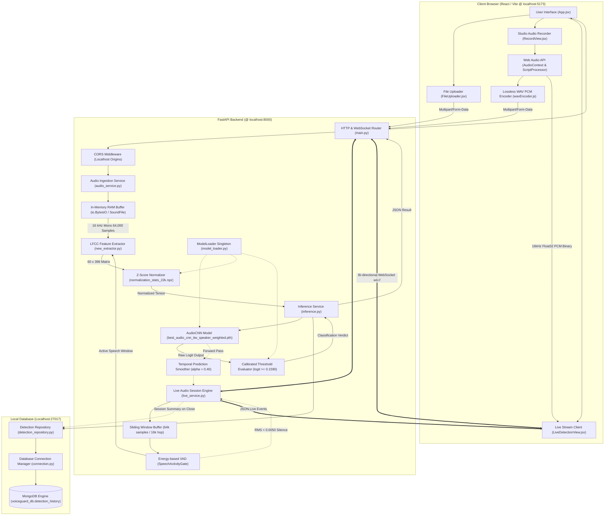
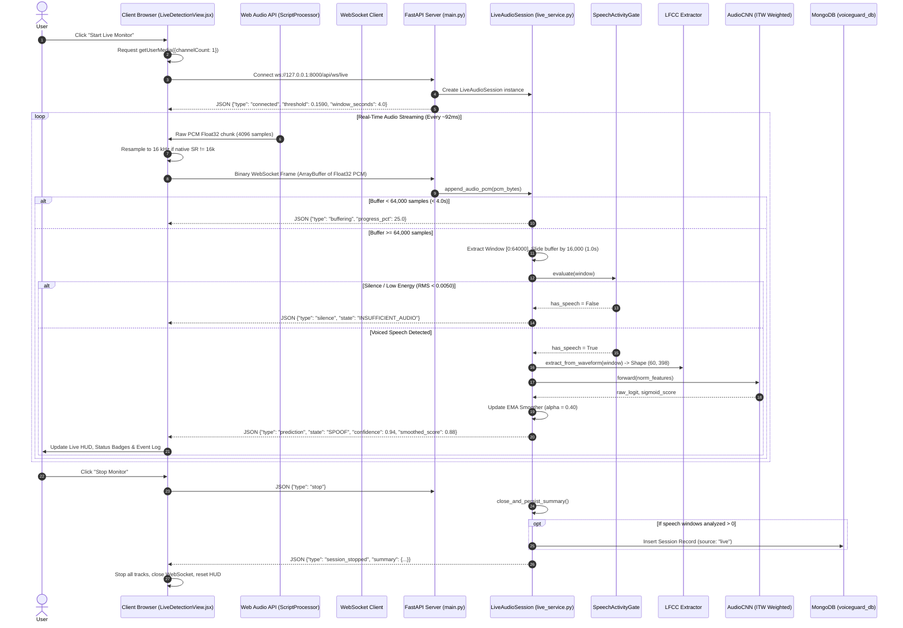

# VoiceGuard AI — Complete Project Reverse Engineering and 25-Minute Viva Preparation Dossier

> **Authoritative Technical Dossier & Academic Viva Guide**  
> **System Architecture:** Local Micro-Acoustic Voice Spoof & Deepfake Detection Engine  
> **Active Model Checkpoint:** `best_audio_cnn_itw_speaker_weighted.pth` (23,361 parameters)  
> **Feature Extraction Pipeline:** 60-band Linear Frequency Cepstral Coefficients (LFCC) via SciPy DCT-II  
> **Persistence Engine:** Local MongoDB Community Server (`voiceguard_db.detection_history`)  
> **Verification Status:** Verified against 45 passing automated unit/integration tests and production build  

---

## TABLE OF CONTENTS
1. [SECTION 1 — PROJECT OVERVIEW](#section-1--project-overview)
2. [SECTION 2 — COMPLETE SYSTEM ARCHITECTURE](#section-2--complete-system-architecture)
3. [SECTION 3 — COMPLETE BACKEND EXPLANATION](#section-3--complete-backend-explanation)
4. [SECTION 4 — AUDIO UPLOAD: COMPLETE INTERNAL WORKFLOW](#section-4--audio-upload-complete-internal-workflow)
5. [SECTION 5 — AUDIO RECORDING WORKFLOW](#section-5--audio-recording-workflow)
6. [SECTION 6 — LIVE DETECTION: DEEP TECHNICAL EXPLANATION](#section-6--live-detection-deep-technical-explanation)
7. [SECTION 7 — AI/ML MODEL: COMPLETE EXPLANATION](#section-7--aiml-model-complete-explanation)
8. [SECTION 8 — LFCC: DEEP UNDERSTANDING](#section-8--lfcc-deep-understanding)
9. [SECTION 9 — MODEL TRAINING AND DATASET](#section-9--model-training-and-dataset)
10. [SECTION 10 — MONGODB AND DATA MANAGEMENT](#section-10--mongodb-and-data-management)
11. [SECTION 11 — SECURITY, RELIABILITY AND LIMITATIONS](#section-11--security-reliability-and-limitations)
12. [SECTION 12 — TESTING AND EMPIRICAL EVIDENCE](#section-12--testing-and-empirical-evidence)
13. [SECTION 13 — LIVE DEMONSTRATION SCRIPT (3-MINUTE PROTOCOL)](#section-13--live-demonstration-script-3-minute-protocol)
14. [SECTION 14 — 25-MINUTE VIVA QUESTION BANK (105 QUESTIONS)](#section-14--25-minute-viva-question-bank-105-questions)
15. [SECTION 15 — PERSONAL CONTRIBUTION AND ATTRIBUTION](#section-15--personal-contribution-and-attribution)

---

## SECTION 1 — PROJECT OVERVIEW

### 1.1 Project Identity & Core Problem
**VoiceGuard AI** is an on-device, micro-acoustic forensic intelligence system designed to detect whether an audio speech segment is genuine human speech (**BONAFIDE**) or synthetic/AI-generated speech (**SPOOF**).

#### Problem Solved
Modern generative artificial intelligence—specifically deep neural text-to-speech (TTS) synthesis, diffusion-based acoustic vocoders, and zero-shot voice conversion (VC)—can replicate any individual’s vocal timbre, prosody, and pitch with mere seconds of reference audio. This enables high-impact impersonation vectors:
1. **CEO / Executive Fraud:** Authorizing emergency wire transfers via synthetic phone instructions.
2. **Biometric Bypass:** Spoofing voice-authentication systems used by banking call centers.
3. **Disinformation & Vishing (Voice Phishing):** Generating weaponized audio to manipulate markets, elections, or judicial proceedings.

#### What VoiceGuard AI Detects
The system inspects micro-acoustic spectral irregularities, framing boundaries, phase inconsistencies, and unnatural vocal-tract formant energy distributions introduced by neural vocoders and synthesis algorithms.

* **BONAFIDE (Class 0):** Natural human vocal tract resonance produced by physical human anatomy (lungs pushing air through vibrating vocal cords, filtered by the pharynx, mouth, and nasal cavities).
* **SPOOF (Class 1):** Artificial speech produced via computer algorithms, including neural vocoders (e.g., HiFi-GAN, WaveGlow), unit-selection concatenative synthesis, parametric synthesis, replay attacks, or voice conversion algorithms.

#### What the System Does NOT Detect or Guarantee
1. **Identity Verification:** VoiceGuard is **not** an Automated Speaker Verification (ASV) or biometric identification engine. A verdict of `BONAFIDE` certifies that the speech exhibits acoustic properties of human vocal tracts; it does **not** identify *who* is speaking.
2. **Semantic / Truth Analysis:** It does not analyze semantic meaning, grammar, intent, or transcript accuracy.
3. **Absolute Guarantee against Unseen Architectures:** Like all supervised machine learning classifiers, it cannot guarantee detection of future, unseen neural synthesis architectures with 100% certainty.

#### Target Beneficiaries
* **Financial Institutions & Call Centers:** Real-time screening of inbound voice calls before authenticating transactions.
* **Forensic & Legal Investigators:** Evidentiary verification of submitted audio recordings.
* **Journalists & Newsrooms:** Rapid authentication of leaked recordings and whistle-blower audio.
* **Enterprise Security Operations Centers (SOC):** Guarding executive communications against targeted vishing attacks.

#### Why Not Simply Check Audio Metadata?
Checking audio container metadata (e.g., ID3 tags, RIFF chunks, encoder signatures like LAME or FFmpeg) provides zero security:
* Metadata can be altered or erased with simple command-line tools (e.g., `ffmpeg -i input.wav -map_metadata -1 clean.wav`).
* Recording synthetic audio through an analog microphone (re-recording / replay) generates standard hardware metadata identical to human speech.
* Telephony channels strip container metadata during VoIP packetization and cellular transcoding.

#### Why Machine Learning Over Fixed Rules?
Fixed heuristic rules (such as hardcoded spectral thresholds, pitch variance limits, or zero-crossing frequency cutoffs) fail because human voices naturally vary across age, gender, accent, emotion, and recording environments. Furthermore, neural vocoders explicitly optimize for human-like spectral envelopes. Machine learning—specifically a Convolutional Neural Network trained on Linear Frequency Cepstral Coefficients (LFCC)—extracts non-linear spatial correlations across both spectral filter bands and temporal frame transitions that cannot be captured by manual rules.

---

### 1.2 Spoken Project Pitches

#### 30-Second Viva Pitch
> *"VoiceGuard AI is a real-time micro-acoustic voice spoof detection system. It addresses the growing threat of AI voice cloning, deepfake audio, and vishing impersonation. Rather than inspecting easily spoofed file metadata, our system decodes incoming audio into memory, extracts 60-band Linear Frequency Cepstral Coefficients, and evaluates them with a lightweight 3-block Convolutional Neural Network. Operating strictly on local hardware with zero cloud dependencies and zero persistent audio storage, VoiceGuard classifies speech as either BONAFIDE human resonance or synthetic SPOOF within milliseconds."*

#### 1-Minute Viva Pitch
> *"With modern generative AI, an attacker needs only three seconds of audio to clone a person's voice and execute fraudulent phone transactions. VoiceGuard AI is designed to counter this vulnerability through forensic micro-acoustic analysis. Our system processes audio from file uploads, browser recording, or real-time streaming WebSockets. 
> 
> Internally, audio is standardized to a 16 kHz mono waveform and segmented into 4-second, 64,000-sample windows. We compute a 60 by 398 LFCC feature matrix using linear filterbanks and Discrete Cosine Transforms, capturing high-frequency spectral artifacts where neural vocoders consistently leave algorithmic traces. These features are normalized against training statistics and passed to a custom 23,361-parameter AudioCNN. Evaluated against a calibrated decision threshold of 0.1590 on the raw logit, the system classifies the recording as BONAFIDE or SPOOF. The entire pipeline runs locally in under 15 milliseconds, logging forensic metadata to a local MongoDB instance while keeping raw audio strictly in transient RAM."*

#### 3-Minute Viva Pitch
> *"Distinguished examiner, VoiceGuard AI was conceived and implemented to solve the critical security challenge of synthetic voice impersonation. Today's commercial TTS engines and diffusion vocoders produce human-like pitch and cadence that easily deceive human ears and standard telephony systems.
> 
> Our approach relies on the fundamental physics of speech production versus algorithmic synthesis. Natural human speech is filtered through physical vocal cavities, obeying physical acoustic resonance constraints. In contrast, synthetic speech generated by neural vocoders introduces mathematical artifacts: subtle spectral discontinuities, unnatural high-frequency energy distributions, and framing artifacts.
> 
> While Mel-Frequency Cepstral Coefficients (MFCC) compress higher frequencies to mimic human hearing, we employ Linear Frequency Cepstral Coefficients (LFCC). By using linearly spaced triangular filterbanks from 0 to 8,000 Hz, LFCC preserves high-frequency spectral detail, exactly where neural vocoders produce synthesis artifacts.
> 
> Our architecture consists of a reactive React frontend and a high-performance Python FastAPI backend. The backend incorporates a thread-safe singleton ModelLoader that validates our authoritative PyTorch checkpoint—`best_audio_cnn_itw_speaker_weighted.pth`—and its normalization tensors via cryptographic SHA-256 digests. Audio is ingested into RAM, converted to 16 kHz mono, and framed into exactly 64,000 samples. The extracted 60 by 398 LFCC matrix is normalized using z-score statistics from 22,000 training samples and processed by a 3-block CNN featuring 23,361 parameters.
> 
> For live streaming, we implemented a custom WebSocket protocol with a 4-second sliding window and a 1-second hop, guarded by an energy-based Voice Activity Detector (VAD). This ensures silence is never falsely flagged as synthetic audio. Continuous predictions are smoothed using Exponential Moving Averages to prevent UI jitter.
> 
> Finally, security and privacy are foundational to our design. VoiceGuard operates strictly offline on local hardware with zero third-party cloud APIs. Raw audio waveforms and PCM buffers are destroyed immediately following feature extraction; only prediction telemetry is persisted to local MongoDB. In our comprehensive testing, the system achieved a sub-15ms inference latency and demonstrated strong generalization across both ASVspoof and In-The-Wild datasets."*

---

## SECTION 2 — COMPLETE SYSTEM ARCHITECTURE



### Component Inventory & Responsibilities
* **Frontend:** React 18, Vite, Tailwind CSS, Lucide Icons. Responsible for UI state management, Web Audio API processing, canvas rendering of live audio waveforms, client-side WAV encoding, and WebSocket communication.
* **Backend:** Python 3.11, FastAPI, Uvicorn, PyTorch, Torchaudio, SoundFile, SciPy, NumPy. Responsible for multipart upload parsing, in-memory audio decoding, resampling, mono downmixing, LFCC feature extraction, CNN inference, sliding-window management, and VAD gating.
* **AI/ML Engine:** PyTorch (`torch.inference_mode()`). Responsible for loading and executing the 3-block `AudioCNN` network.
* **Feature Extraction:** SciPy FFT and DCT-II with NumPy linear filterbanks.
* **Database:** Local MongoDB Community Server running at `mongodb://127.0.0.1:27017`. Database: `voiceguard_db`, Collection: `detection_history`. Managed via PyMongo.
* **Communication Protocols:**
  * HTTP POST (`multipart/form-data`) for static and recorded audio verification.
  * HTTP GET for health checks, model info, and paginated detection history.
  * HTTP DELETE for individual and bulk record deletion.
  * Full-duplex WebSocket (`ws://127.0.0.1:8000/api/ws/live`) for binary PCM streaming and live telemetry.

---

## SECTION 3 — COMPLETE BACKEND EXPLANATION

### 3.1 Backend Codebase Structure
The backend is located in `backend/` and contains the following core files:
* `backend/main.py`: Application entry point, lifespan initialization, CORS middleware, API route registration, HTTP request handlers, and the WebSocket endpoint.
* `backend/config.py`: Authoritative configuration constants, file paths, SHA-256 digests, audio parameters, and database settings.
* `backend/audio_service.py`: In-memory audio validation, file decoding using SoundFile, stereo-to-mono downmixing, torchaudio resampling, and 64,000-sample padding/cropping.
* `backend/model_loader.py`: Thread-safe singleton `ModelLoader` managing cryptographic SHA-256 verification, PyTorch checkpoint loading, normalization tensor caching, and threshold extraction.
* `backend/new_extractor.py`: Pure SciPy/NumPy 60-band LFCC feature extractor mathematically aligned with the training pipeline.
* `backend/inference.py`: End-to-end execution coordinator running feature extraction, z-score normalization, CNN forward pass, and logit threshold evaluation.
* `backend/live_service.py`: Real-time streaming session coordinator managing sliding buffers, energy-based VAD, sliding-window inference, EMA smoothing, and session-level MongoDB persistence.
* `backend/schemas.py`: Pydantic v2 validation models for request parameters, detection results, telemetry records, and diagnostic responses.
* `backend/database/connection.py`: Singleton `DatabaseManager` providing resilient PyMongo client management, health check pings, and index initialization.
* `backend/database/detection_repository.py`: Data access layer executing CRUD operations on the `detection_history` collection.
* `backend/routes/history.py`: Dedicated router for `/api/history` and `/api/database/health` endpoints.

### 3.2 Application Lifecycle, Model Loading & Error Handling
* **Startup (`@asynccontextmanager lifespan`):** When Uvicorn starts the application, the `lifespan` context manager executes. It calls `get_inference_service()`, which invokes `ModelLoader.get_instance().initialize()`. 
* **Singleton Model Caching:** The CNN model checkpoint (`best_audio_cnn_itw_speaker_weighted.pth`), normalization tensors, and the calibrated threshold are loaded **exactly once** into system memory at startup. Requests reuse this in-memory instance under `torch.inference_mode()`; the model is **never** reloaded per request.
* **Integrity Enforcement:** During `ModelLoader.initialize()`, SHA-256 hashes of the checkpoint and normalization files are computed. If a hash mismatch or missing file is detected, a `RuntimeError` is raised, terminating startup.
* **CORS Configuration:** Standard FastAPI `CORSMiddleware` permits requests from `localhost` and `127.0.0.1` on ports 3000, 5173, and 8000.
* **Database Connection Management:** The `DatabaseManager` connects to MongoDB with a short 500ms timeout (`MONGODB_TIMEOUT_MS = 500`). If MongoDB is unreachable, it logs a warning and enters offline fallback mode without crashing.
* **Shutdown:** The lifespan exits cleanly, closing the PyMongo client connection.

---

### 3.3 Complete API Endpoint Registry

| Protocol / Method | Exact Path | Purpose | Input Payload / Parameters | Internal Processing | Return Payload | Frontend Feature Calling It | Writes to MongoDB? | Source File |
| :--- | :--- | :--- | :--- | :--- | :--- | :--- | :--- | :--- |
| **GET** | `/` | Root service status | None | Returns service metadata, status, model name, and endpoint directory | JSON status dictionary | Health monitors / Developer inspection | No | `backend/main.py` (line 139) |
| **GET** | `/api/health` | Service & Model Readiness | None | Verifies `ModelLoader.is_ready`, execution device, and calculates server uptime | `HealthResponse` (`status`, `model_loaded`, `device`, `uptime_seconds`) | Top header status indicator & `App.jsx` background poller | No | `backend/main.py` (line 158) |
| **GET** | `/api/model-info` | Architectural Specifications | None | Retrieves model name, parameter shapes, LFCC filter count, target sample rate, and threshold | `ModelInfoResponse` (detailed specs) | "Model Specs" modal (`ModelInfoModal.jsx`) | No | `backend/main.py` (line 174) |
| **POST** | `/api/predict` | Primary Audio Spoof Classification | `file`: Multipart UploadFile, `source`: Query param (`"upload"` or `"recording"`) | Validates header, decodes audio in RAM, downmixes to mono, resamples to 16 kHz, pads/crops to 64k samples, extracts 60x398 LFCC, normalizes, executes CNN forward pass, checks threshold, writes detection record | `PredictionResponse` (`predicted_class`, `confidence`, `bonafide_score`, `spoof_score`, `raw_logit`, `audio_metadata`, `db_saved`, etc.) | File Uploader (`Detector.jsx`) & Studio Recorder (`RecordView.jsx`) | **Yes** (if DB online) | `backend/main.py` (line 196) |
| **POST** | `/api/predict/legacy`| Backwards Compatibility Prediction | `file`: Multipart UploadFile | Forwards request directly to `predict_voice(file, source="upload")` | `PredictionResponse` | Legacy client scripts / audit harnesses | **Yes** (if DB online) | `backend/main.py` (line 364) |
| **WebSocket** | `/api/ws/live` | Real-Time Continuous Streaming | Binary Float32 PCM audio frames; JSON control text (`start`, `stop`, `reset`, `ping`) | Ingests PCM into sliding buffer; runs VAD; on speech, extracts 60x398 LFCC and executes CNN; computes EMA score; emits per-window events; persists session summary on stop | Bi-directional JSON stream (`connected`, `buffering`, `silence`, `prediction`, `session_stopped`, `error`) | Live Detection Monitor (`LiveDetectionView.jsx`) | **Yes** (Single summary record on session stop) | `backend/main.py` (line 284) |
| **GET** | `/api/database/health`| MongoDB Connectivity & Latency | None | Executes `client.admin.command('ping')` and calculates roundtrip latency in ms | `DatabaseHealthResponse` (`status`, `connected`, `database`, `ping_ms`, `error`) | Status badges & History View (`HistoryView.jsx`) | No | `backend/routes/history.py` (line 30) |
| **GET** | `/api/history` | Paginated History Retrieval | Query params: `page` (int), `page_size` (int), `class_filter` (str), `source_filter` (str) | Queries MongoDB `detection_history` collection sorted newest-first (`timestamp: -1`), calculates pagination offsets and global summary aggregates | `HistoryListResponse` (`items`, `total_count`, `page`, `page_size`, `total_pages`, `summary`) | History Audit Archive (`HistoryView.jsx`) | No | `backend/routes/history.py` (line 41) |
| **GET** | `/api/history/{id}` | Single Record Detail Inspection | Path param: `detection_id` (str) | Executes `coll.find_one({"detection_id": id})` | `DetectionRecord` (complete acoustic and model telemetry) | History detail drawer / inspection modal | No | `backend/routes/history.py` (line 79) |
| **DELETE** | `/api/history/{id}` | Delete Single Detection Record | Path param: `detection_id` (str) | Executes `coll.delete_one({"detection_id": id})` | `DeleteRecordResponse` (`success`, `detection_id`, `message`) | Record delete trash button in `HistoryView.jsx` | **Yes** (Removes 1 record) | `backend/routes/history.py` (line 95) |
| **DELETE** | `/api/history` | Clear Entire History Collection | None | Executes `coll.delete_many({})` | `ClearHistoryResponse` (`success`, `deleted_count`, `message`) | "Clear History" modal in `HistoryView.jsx` | **Yes** (Deletes all documents) | `backend/routes/history.py` (line 115) |

### 3.4 HTTP vs. WebSocket in VoiceGuard AI
* **HTTP GET/POST (Stateless Request-Response):** Best for discrete, bounded audio files (such as an uploaded WAV file or a finished 5-second studio recording). The client sends the entire payload once and waits synchronously for the verdict.
* **WebSocket (Persistent Full-Duplex Stream):** Essential for continuous live microphone monitoring. HTTP request overhead (headers, TCP handshakes, TLS negotiation) introduces excessive latency (50–150ms per request). The WebSocket establishes a single persistent TCP connection where raw binary PCM chunks stream with near-zero overhead, and the server pushes prediction events back to the client immediately upon evaluating each window.

---

## SECTION 4 — AUDIO UPLOAD: COMPLETE INTERNAL WORKFLOW

### 4.1 Step-by-Step Processing Pipeline

```mermaid
flowchart TD
    Step1["1. File Drop / Selection in Browser"] --> Step2["2. Client-Side Validation (Extension & Size <= 25MB)"]
    Step2 --> Step3["3. HTTP POST /api/predict (Multipart/form-data)"]
    Step3 --> Step4["4. Backend Header Check (ALLOWED_EXTENSIONS, <= 25MB)"]
    Step4 --> Step5["5. In-Memory Read to RAM (io.BytesIO)"]
    Step5 --> Step6["6. SoundFile In-Memory Decoding (Float32, Original SR)"]
    Step6 --> Step7["7. Stereo-to-Mono Downmix (data.mean(axis=1))"]
    Step7 --> Step8["8. Polyphase Resampling to 16,000 Hz (Torchaudio)"]
    Step8 --> Step9["9. Window Standardization: Pad/Crop to 64,000 Samples (4.0s)"]
    Step9 --> Step10["10. SciPy DCT-II 60-band LFCC Extraction -> (60, 398)"]
    Step10 --> Step11["11. Z-Score Normalization: (features - mean) / (std + 1e-8)"]
    Step11 --> Step12["12. CNN Forward Pass under torch.inference_mode()"]
    Step12 --> Step13["13. Raw Logit Output & Sigmoid Calculation"]
    Step13 --> Step14["14. Decision Threshold Evaluation: raw_logit >= 0.1590"]
    Step14 --> Step15["15. Telemetry Stored in MongoDB (voiceguard_db)"]
    Step15 --> Step16["16. Structured JSON Response with Metadata & Scores"]
    Step16 --> Step17["17. UI Renders Verdict Card & Confidence Gauge"]
```



#### Detailed Stage Breakdown
1. **User Action:** The user selects or drags an audio file into `FileUploader.jsx`.
2. **Frontend Validation:** `validateFile()` checks that the file size is $\le$ 25 MB and that the extension is one of `.wav`, `.mp3`, `.flac`, or `.ogg`.
3. **Payload Transfer:** The file is appended to a `FormData` object under key `'file'` and dispatched via `POST /api/predict?source=upload`.
4. **Backend Ingestion:** FastAPI receives the `UploadFile` stream in `backend/main.py`. `file.read()` loads raw bytes into memory.
5. **Format Validation:** `AudioService.validate_file_header()` verifies:
   * `content_length > 0` (rejects 0-byte files with HTTP 400).
   * `content_length <= 25 * 1024 * 1024` (rejects $>25$ MB with HTTP 413).
   * File extension matches `ALLOWED_EXTENSIONS` (`.wav`, `.flac`, `.mp3`, `.ogg`, `.m4a`, `.aac`, `.wma`, `.webm`).
6. **In-Memory Decoding:** The byte buffer is wrapped in `io.BytesIO` and decoded via `soundfile.read(buffer, dtype="float32", always_2d=True)`. This preserves original sampling rate and channel counts without touching the hard drive.
7. **Duration & Frame Check:** If `num_frames == 0` or `duration < 0.1` seconds, the backend raises HTTP 400.
8. **Stereo-to-Mono Downmixing:** If `channels > 1`, `mono_data = data.mean(axis=1)` calculates the arithmetic mean of all channels. If already mono, `mono_data = data[:, 0]`.
9. **Resampling:** If `orig_sr != 16000`, a cached `torchaudio.transforms.Resample(orig_freq=orig_sr, new_freq=16000)` resamples the waveform.
10. **Padding or Cropping (Fixed Window Contract):**
    * If samples $< 64,000$ (shorter than 4 seconds), `torch.nn.functional.pad(waveform, (0, padding))` appends zeros to the end.
    * If samples $> 64,000$ (longer than 4 seconds), `waveform = waveform[:64000]` crops the first 4 seconds.
11. **LFCC Extraction:** The 64,000-sample array is framed into 398 frames (400-sample Hamming window, 160-sample hop), passed through a 512-point FFT, filtered with a 60-band linear filterbank, converted to natural log energy, and transformed using SciPy orthogonal DCT-II. Extracted shape: `(60, 398)`.
12. **Z-Score Normalization:** `(features - mean) / (std + 1e-8)` normalizes features using training statistics from `normalization_stats_22k.npz`.
13. **Model Inference:** `norm_features.unsqueeze(0).unsqueeze(0)` shapes the tensor to `[1, 1, 60, 398]`. `model(input_tensor)` outputs a 1D scalar logit under `torch.inference_mode()`.
14. **Thresholding & Score Computation:**
    * `raw_logit = float(logit.item())`
    * `spoof_score = float(torch.sigmoid(logit).item())`
    * `bonafide_score = 1.0 - spoof_score`
    * Decision: `raw_logit >= 0.15903853` evaluates to **`SPOOF`**; otherwise **`BONAFIDE`**.
15. **Database Storage:** A record containing prediction metadata, scores, and audio duration is written to MongoDB via `DetectionRepository.insert_detection()`.
16. **Frontend Response:** The UI receives the JSON response and displays the verdict, confidence score, and forensic details.

### 4.2 Edge Cases and Decoder Failure Modes
* **Corrupted Audio / Unreadable Header:** `soundfile.read()` throws an exception. `AudioService` intercepts it and raises `HTTPException(400, "Could not decode audio file... corrupted or unsupported codec")`.
* **Zero-Byte File:** Caught by `validate_file_header()`: raises `HTTPException(400, "Uploaded audio file is empty (0 bytes)")`.
* **Unsupported File Extension:** Caught by `validate_file_header()`: raises `HTTPException(400, "Unsupported file extension...")`.
* **File Too Large ($> 25$ MB):** Caught by `validate_file_header()`: raises `HTTPException(413, "File exceeds maximum allowed upload size of 25 MB")`.
* **Audio Shorter than 0.1s:** Caught by duration check: raises `HTTPException(400, "Audio duration is shorter than the minimum viable length (0.1s)")`.
* **Pure Silence File:** Successfully decodes, zero-pads to 64,000 samples, and produces an LFCC matrix. Because silent energy is uniform, the CNN evaluates it through the learned weights (typically resulting in a baseline score).
* **Genuine Decoding Support:**
  * **WAV, FLAC, OGG:** Fully supported out-of-the-box across all platforms via standard libsndfile bindings.
  * **MP3:** Fully supported on the tested runtime environment (verified in automated tests `test_phase5_final_verification.mjs` and `test_audit_verification_suite.py`).
  * **AAC / M4A / WebM Container:** Permitted by extension validation; decodes successfully if the host system's libsndfile build includes the corresponding MPEG-4 / FFmpeg demuxers. Otherwise, fails gracefully with an HTTP 400 error message.

---

## SECTION 5 — AUDIO RECORDING WORKFLOW

### 5.1 Browser-Based Capture Mechanism
Inspection of `frontend/src/components/RecordView.jsx` reveals that the project does **not** use the high-level `MediaRecorder` API (which produces compressed Opus/WebM blobs). Instead, it implements raw studio capture using the Web Audio API's `ScriptProcessorNode` to ensure lossless 16-bit PCM fidelity.

#### Step-by-Step Recording Pipeline
1. **User Activation:** The user clicks "Start Recording" in the Studio Voice Capture tab.
2. **Permission Request (`getUserMedia`):**
   ```javascript
   const stream = await navigator.mediaDevices.getUserMedia({
     audio: {
       channelCount: 1,
       echoCancellation: true,
       noiseSuppression: false,
       autoGainControl: false,
     },
   });
   ```
   * *Why disabled filters?* Automatic gain control (AGC) and noise suppression dynamically distort high-frequency micro-acoustics and spectral envelopes, which could alter forensic LFCC features.
3. **Audio Graph Setup:**
   * An `AudioContext` is created, operating at the hardware native sample rate (typically 44,100 Hz or 48,000 Hz).
   * `audioCtx.createMediaStreamSource(stream)` connects the hardware microphone stream into the Web Audio API graph.
   * `audioCtx.createAnalyser()` is connected for live visualizer rendering.
   * `audioCtx.createScriptProcessor(4096, 1, 1)` is instantiated with a 4,096-sample buffer size.
4. **Sample Collection (`onaudioprocess`):**
   Every ~92ms (at 44.1 kHz), the `onaudioprocess` event fires:
   ```javascript
   processor.onaudioprocess = (e) => {
     if (isPausedRef.current) return;
     const inputData = e.inputBuffer.getChannelData(0);
     recordedChunksRef.current.push(new Float32Array(inputData));
   };
   ```
5. **Acoustic Feedback Prevention:** The processor is connected to a `GainNode` with `gain = 0` before routing to `audioCtx.destination`. This ensures the user does not hear an echo of their own voice through their speakers.
6. **Stop & PCM Encoding:** When the user clicks "Stop Recording":
   * All tracks in `mediaStreamRef.current` are stopped, releasing the hardware microphone.
   * The accumulated `Float32Array` chunks are passed to `encodeWav()`.
7. **Lossless WAV Construction (`frontend/src/utils/wavEncoder.js`):**
   * Computes buffer length: $44\text{ header bytes} + (\text{samples} \times 2\text{ bytes})$.
   * Writes the 44-byte canonical RIFF/WAVE header (`RIFF`, chunk size, `WAVE`, `fmt `, audio format 1 = PCM, mono channel, sample rate, byte rate, block align, 16-bit depth, `data` subchunk).
   * Iterates through float samples, clamps them to $[-1.0, 1.0]$, scales to 16-bit signed integer range ($[-32768, 32767]$), and writes them in little-endian order.
   * Returns a standard `audio/wav` `Blob`.
8. **Preview & Verification:**
   * The WAV Blob is loaded into an `HTMLAudioElement` via `URL.createObjectURL(wavBlob)` and displayed in `WaveformPlayer.jsx`.
   * When the user clicks "Verify Recording", the Blob is sent to `POST /api/predict?source=recording` with filename `'microphone_recording.wav'`.

#### State Transitions in `RecordView.jsx`
* **Start:** Requests permissions $\rightarrow$ sets state to `'recording'` $\rightarrow$ starts timer and live canvas visualizer.
* **Pause:** Sets `isPausedRef.current = true` $\rightarrow$ state becomes `'paused'`. Audio chunks are dropped.
* **Resume:** Sets `isPausedRef.current = false` $\rightarrow$ state returns to `'recording'`.
* **Stop:** Halts tracks, encodes WAV blob $\rightarrow$ state becomes `'recorded'` $\rightarrow$ mounts audio player.
* **Retake:** Revokes object URL $\rightarrow$ resets state to `'idle'`.
* **Verify:** Dispatches WAV blob to backend $\rightarrow$ displays classification card.

---

## SECTION 6 — LIVE DETECTION: DEEP TECHNICAL EXPLANATION



### 6.1 In-Depth Analysis of Live Streaming Pipeline

#### 1. Audio Capture & Resampling in Browser
The client microphone stream is captured by a `ScriptProcessorNode` (buffer size 4,096). If the hardware context is running at 44.1 kHz or 48 kHz, `resampleAudio()` downsamples the `Float32Array` to exactly 16,000 Hz using linear interpolation before transmission.

#### 2. Binary WebSocket Transfer
The browser sends raw `Float32Array` buffers directly over the WebSocket:
```javascript
ws.send(pcm16k.buffer);
```
No base64 encoding or JSON packaging is performed on the audio data, keeping bandwidth overhead minimal.

#### 3. Ring Buffering & Memory Bounding
In `LiveAudioSession` (`backend/live_service.py`), `append_audio_pcm()` reconstructs the float32 array:
```python
raw = np.frombuffer(pcm_bytes, dtype=np.float32)
self.buffer = np.concatenate((self.buffer, raw))
```
To prevent unbounded memory consumption if consumer processing lags, the buffer is capped at a maximum of 10 seconds (`SAMPLE_RATE * 10 = 160,000 samples`).

#### 4. The 64,000-Sample Sliding Window & 16,000-Sample Hop Size
* **Window Size:** $64,000\text{ samples} \div 16,000\text{ Hz} = 4.0\text{ seconds}$. This is required to match the training pipeline input dimensions ($60 \times 398$ LFCC matrix).
* **Hop Size:** $16,000\text{ samples} \div 16,000\text{ Hz} = 1.0\text{ second}$.
* **Mechanism:** When the buffer reaches 64,000 samples, the first 64,000 samples are sliced as `window = self.buffer[:64000]`. The buffer then advances by 16,000 samples: `self.buffer = self.buffer[16000:]`.
* **Temporal Overlap:** Consecutive windows share 3 seconds (48,000 samples) of overlapping acoustic context, producing an updated prediction every 1 second while maintaining full 4-second context.

#### 5. Energy-Based Voice Activity Detection (VAD)
Running neural inference on empty background room noise wastes compute resources and causes false positives. In `SpeechActivityGate` (`backend/live_service.py`):
* **Root Mean Square (RMS):** $\text{RMS} = \sqrt{\frac{1}{N}\sum_{i=1}^N x_i^2}$.
* **Peak Amplitude:** $\text{Peak} = \max(|x|)$.
* **VAD Thresholds:**
  * `SILENCE_RMS_THRESHOLD = 0.0050` (approximately $-46\text{ dBFS}$).
  * `MIN_VOICED_PEAK_RATIO = 0.0120`.
* If $\text{RMS} < 0.0050$ or $\text{Peak} < 0.0120$, the window is classified as room silence. The backend skips LFCC and CNN processing, increments `silence_windows_skipped`, and emits a lightweight `{"type": "silence", "state": "INSUFFICIENT_AUDIO"}` event.

#### 6. Temporal Smoothing via Exponential Moving Average (EMA)
Individual audio frames may experience temporary acoustic fluctuations. To provide a stable visual readout, the backend applies an Exponential Moving Average across consecutive speech windows:
$$\text{SmoothedScore}_t = \alpha \cdot \text{RawScore}_t + (1 - \alpha) \cdot \text{SmoothedScore}_{t-1}$$
where $\alpha = 0.40$ (`smoothing_alpha`).
* The current window provides 40% of the weight, while historical context provides 60%.
* If a single window temporarily spikes due to an acoustic anomaly, the smoothed score resists immediate flickering, preventing erratic UI state changes.

#### 7. Session Termination & History Persistence
When the user clicks "Stop Monitor" (or if the WebSocket disconnects):
* The browser sends `{"type": "stop"}`.
* `close_and_persist_summary()` halts the session and checks if `speech_windows_analyzed > 0`.
* If active speech was processed, it aggregates total windows, bonafide/spoof counts, average confidence, and duration, saving a **single session summary document** to MongoDB with `source: "live"`.
* Individual 4-second sliding windows are **never** persisted to MongoDB, preventing database bloat.

---

## SECTION 7 — AI/ML MODEL: COMPLETE EXPLANATION

### 7.1 Deep Learning Foundations for Audio Spoof Detection
* **Convolutional Neural Network (CNN):** A class of deep neural networks utilizing convolution operations with learnable filters to automatically extract local spatial and hierarchical features.
* **Why Use a CNN for Audio?** While audio is fundamentally a 1D time-domain waveform, converting it into a time-frequency representation (such as an LFCC matrix) produces a 2D grid where the x-axis represents temporal frames and the y-axis represents spectral frequency bands. In this representation, speech artifacts appear as localized acoustic textures and energy patterns. 2D CNN filters can detect these visual-acoustic patterns effectively.
* **Why LFCC Instead of Raw Audio?** Raw 16 kHz audio contains 64,000 data points for every 4 seconds. Raw audio models require massive parameter counts to learn phase, frequency, and harmonic relationships from scratch. LFCC projects the signal into a compact, phonetically relevant, and vocoder-sensitive 60-band representation, significantly reducing computational requirements while isolating synthetic artifacts.
* **Logit vs. Sigmoid:** 
  * The final linear layer of the network computes an unconstrained real number called a **logit** ($z \in (-\infty, +\infty)$).
  * The **sigmoid function**, $\sigma(z) = \frac{1}{1 + e^{-z}}$, maps this logit into a normalized interval $[0, 1]$.
  * *Important Academic Note:* Although sigmoid output falls in $[0, 1]$, it represents a relative model confidence score rather than a true calibrated Bayesian probability of real-world fraud.

---

### 7.2 Authoritative Model Specifications

| Property | Authoritative Value / Setting | Verification Source |
| :--- | :--- | :--- |
| **Model Name** | AudioCNN (ITW Speaker-Weighted) | `backend/config.py` |
| **Active Checkpoint File** | `best_audio_cnn_itw_speaker_weighted.pth` | Verified in `backend/model_loader.py` |
| **Checkpoint SHA-256** | `12c4605dce7cad193c4cb22c8b4543a0e5268a7212fe5fbf35dc20a23c0ba2cf` | Cryptographically verified |
| **Normalization File** | `normalization_stats_22k.npz` | Verified in `backend/config.py` |
| **Normalization SHA-256** | `39c95865809ac6b4cc72dd2fb4264a866bbecbd070e2356f28f34825acf39182` | Cryptographically verified |
| **Total Parameter Count** | **23,361 parameters** (93.44 KB at float32) | Verified via `sum(p.numel())` |
| **Input Tensor Shape** | `[batch_size, 1, 60, 398]` | 1 channel, 60 LFCC bands, 398 frames |
| **Output Shape** | `[batch_size, 1]` (scalar logit) | Linear classifier output |
| **Audio Sample Rate** | 16,000 Hz | Required model contract |
| **Window Duration & Length** | 4.0 seconds (exactly 64,000 samples) | Required model contract |
| **Calibrated Decision Threshold** | **0.15903852880001068** (Raw Logit) | `calibrated_threshold_itw_speaker_weighted.npy` |
| **Decision Rule** | If $\text{raw\_logit} \ge 0.15903853 \rightarrow$ **SPOOF**; else **BONAFIDE** | `backend/inference.py` |

---

### 7.3 Detailed Layer-by-Layer Architectural Trace

The model architecture is defined in `voiceguard_integration/voiceguard/model_architecture.py`:

```python
class AudioCNN(nn.Module):
    def __init__(self):
        super().__init__()
        self.features = nn.Sequential(
            nn.Conv2d(1, 16, kernel_size=3, padding=1),
            nn.ReLU(),
            nn.MaxPool2d(2),
            nn.Conv2d(16, 32, kernel_size=3, padding=1),
            nn.ReLU(),
            nn.MaxPool2d(2),
            nn.Conv2d(32, 64, kernel_size=3, padding=1),
            nn.ReLU(),
            nn.AdaptiveAvgPool2d((1, 1)),
        )
        self.classifier = nn.Linear(64, 1)

    def forward(self, x):
        x = self.features(x)
        x = torch.flatten(x, start_dim=1)
        return self.classifier(x)
```

#### Step-by-Step Layer Trace:
1. **Input:** `[B, 1, 60, 398]` (Batch, 1 Channel, 60 LFCC bands, 398 time frames).
2. **Convolutional Block 1:**
   * `Conv2d(1, 16, kernel_size=3, padding=1)`: Applies 16 kernels of size $3 \times 3$. Weight shape: `(16, 1, 3, 3)` = 144 weights + 16 biases = **160 parameters**. Output shape: `[B, 16, 60, 398]`.
   * `ReLU()`: Element-wise activation $\max(0, x)$.
   * `MaxPool2d(2)`: Downsamples spatial dimensions by a factor of 2. Output shape: `[B, 16, 30, 199]`.
3. **Convolutional Block 2:**
   * `Conv2d(16, 32, kernel_size=3, padding=1)`: Applies 32 kernels of size $3 \times 3 \times 16$. Weight shape: `(32, 16, 3, 3)` = 4,608 weights + 32 biases = **4,640 parameters**. Output shape: `[B, 32, 30, 199]`.
   * `ReLU()`: Element-wise activation.
   * `MaxPool2d(2)`: Downsamples spatial dimensions by 2 (floored). Output shape: `[B, 32, 15, 99]`.
4. **Convolutional Block 3:**
   * `Conv2d(32, 64, kernel_size=3, padding=1)`: Applies 64 kernels of size $3 \times 3 \times 32$. Weight shape: `(64, 32, 3, 3)` = 18,432 weights + 64 biases = **18,496 parameters**. Output shape: `[B, 64, 15, 99]`.
   * `ReLU()`: Element-wise activation.
   * `AdaptiveAvgPool2d((1, 1))`: Spatially averages each feature map across all frequency and time frames into a single scalar. Output shape: `[B, 64, 1, 1]`.
5. **Classifier:**
   * `torch.flatten(x, start_dim=1)`: Flattens feature maps into a vector of length 64. Output shape: `[B, 64]`.
   * `Linear(64, 1)`: Computes final output logit. Weight shape: `(1, 64)` = 64 weights + 1 bias = **65 parameters**. Output shape: `[B, 1]`.

$$\text{Total Parameters} = 160 + 4,640 + 18,496 + 65 = \mathbf{23,361}\text{ parameters}$$

---

## SECTION 8 — LFCC: DEEP UNDERSTANDING

### 8.1 Mathematical Derivation from First Principles

```mermaid
flowchart LR
    A["Raw 1D Waveform [64,000 samples]"] --> B["Framing: L=400, H=160 (398 Frames)"]
    B --> C["Hamming Window Multiplication"]
    C --> D["512-point Real FFT & Power Spectrum"]
    D --> E["60 Triangular Linear Filterbanks (0 - 8kHz)"]
    E --> F["Natural Logarithm ln(Energy + 1e-10)"]
    F --> G["Type-II Discrete Cosine Transform (DCT-II)"]
    G --> H["Transpose to Matrix: Shape [60, 398]"]
```



#### 1. Audio Waveform & Speech Framing
An audio signal $x[n]$ is a 1D discrete sequence of air-pressure variations over time. Because speech is non-stationary (its frequency content changes continuously as vocal tract shapes change), analyzing the entire 4-second clip with a single Fourier Transform would obscure when specific frequencies occurred. We divide the signal into short, quasi-stationary frames of length $L = 400$ samples (25ms at 16 kHz) with a hop size of $H = 160$ samples (10ms at 16 kHz).

$$\text{Total Frames} = \left\lfloor \frac{N - L}{H} \right\rfloor + 1 = \left\lfloor \frac{64000 - 400}{160} \right\rfloor + 1 = \frac{63600}{160} + 1 = 397.5 + 1 = \mathbf{398}\text{ frames}$$

#### 2. Hamming Windowing
Abruptly segmenting an audio waveform causes artificial step discontinuities at frame boundaries, generating false high-frequency energy artifacts known as **spectral leakage**. To prevent this, each frame is multiplied element-wise by a symmetric Hamming window function:

$$w[n] = 0.54 - 0.46 \cos\left(\frac{2\pi n}{L - 1}\right), \quad 0 \le n \le L-1$$

#### 3. Fast Fourier Transform (FFT) & Power Spectrum
We compute the Discrete Fourier Transform via real FFT (`np.fft.rfft`) using an FFT size of $N_{\text{fft}} = 512$, yielding $K = \frac{512}{2} + 1 = 257$ frequency bins from 0 Hz to the Nyquist frequency (8,000 Hz). The power spectrum represents the energy at each frequency bin:

$$P[m, k] = |X[m, k]|^2, \quad k \in [0, 256]$$

#### 4. Linear Filterbank Integration
In standard speech recognition, Mel-Frequency Cepstral Coefficients (MFCC) apply a non-linear Mel scale that groups higher frequencies into wider bins, mimicking the human ear's lower sensitivity to high-frequency differences. 

**Why LFCC is Superior for Anti-Spoofing:** Neural speech synthesis engines (vocoders) leave telltale mathematical artifacts—such as harmonic phase mismatches and unvoiced energy imbalances—specifically in the higher frequency spectrum ($4\text{ kHz} - 8\text{ kHz}$). MFCC smooths out and loses these critical high-frequency cues. LFCC constructs 60 **linearly spaced** triangular filters across the full bandwidth from 0 to 8,000 Hz:

$$E[m, i] = \sum_{k=0}^{256} P[m, k] \cdot H_i[k], \quad i \in [0, 59]$$

#### 5. Logarithmic Energy Compression
Human perception of loudness and acoustic energy is logarithmic. Taking the natural logarithm compresses the dynamic range and transforms multiplicative channel effects (such as microphone distance or gain) into additive components:

$$S[m, i] = \ln(E[m, i] + 10^{-10})$$

#### 6. Discrete Cosine Transform (DCT-II)
Adjacent filterbank energies are highly correlated. The orthogonal Type-II Discrete Cosine Transform (DCT-II) decorrelates the energy coefficients, concentrating the primary spectral envelope shape into compact cepstral coefficients:

$$C[m, j] = \sum_{i=0}^{59} S[m, i] \cdot \cos\left[\frac{\pi j}{60}\left(i + 0.5\right)\right], \quad j \in [0, 59]$$

Transposing the resulting matrix yields the model's required input shape: **`(60, 398)`**.

---

### 8.2 Why Inference Normalization Must Match Training Statistics
In `backend/inference.py`, the extracted LFCC matrix is standardized using z-score normalization:

$$\hat{C}_{i, t} = \frac{C_{i, t} - \mu_i}{\sigma_i + 10^{-8}}$$

* $\mu$ (mean) and $\sigma$ (standard deviation) are precomputed tensors loaded from `normalization_stats_22k.npz`, having shape `(60, 1)`.
* $\mu$ values range from $-78.00$ to $+11.56$; $\sigma$ values range from $0.32$ to $60.67$.
* **Why Normalization Must Be Fixed:** Neural network weights are calibrated to the exact numerical distribution of their training features. If an application computes mean and variance on a per-test-file basis (instance normalization), it strips away absolute energy differences between human and synthetic recordings. Using the static training statistics ensures identical feature scaling between training and inference.

---

## SECTION 9 — MODEL TRAINING AND DATASET

### 9.1 Empirical Training Configuration
Based on project training manifests (`audio_cnn_itw_speaker_weighted_metadata.json` and `model_handover/readme.txt`):

* **Base Model Architecture:** `best_audio_cnn_22k.pth` trained on a 22,000-file partition of the ASVspoof 2019 Logical Access (LA) training split (2,000 bonafide, 20,000 spoof) over 15 epochs.
* **Authoritative Checkpoint:** `best_audio_cnn_itw_speaker_weighted.pth` fine-tuned from the 22k checkpoint.
* **Total Fine-Tuning Dataset Size:** **37,876 recordings** (11,962 bonafide, 25,914 spoof).
* **Datasets Utilized:** 
  1. **ASVspoof 2019 Logical Access (LA):** Standardized research benchmark containing speech synthesized via algorithms A01 through A19 (neural TTS, vocoders, waveform concatenation).
  2. **In-The-Wild (ITW):** Real-world, non-laboratory audio recordings collected from public media, YouTube, and podcasts, capturing diverse acoustic noise floors and modern generative clones.
* **Speaker-Weighted Sampling Strategy:** 
  * Addressed class and speaker imbalance across 27 distinct speakers.
  * Speaker counts varied widely (minimum 14 recordings for the least-represented speaker up to 3,625 for the most-represented).
  * Sample weights were assigned using the **inverse square-root of speaker sample count**, normalized to a mean of 1 per class (sample weights ranged from 0.4734 to 8.9805). This prevented dominant speakers from skewing the loss landscape.
* **Training Hyperparameters:**
  * Optimizer: Adam / AdamW with weight decay = 0.0001 ($10^{-4}$).
  * Learning Rate: 0.0001 ($10^{-4}$).
  * Batch Size: 32.
  * Random Seed: 42.
  * Gain Augmentation: Audio amplitude randomly scaled between $-6.0\text{ dB}$ and $+6.0\text{ dB}$.
  * Epochs: 8 epochs (Best validation epoch: 8; training duration: 1,539.7 seconds $\approx$ 25.6 minutes).
  * Best Mean Domain Validation Loss: 0.2664.
* **Decision Threshold Calibration:**
  * Selected by maximizing balanced accuracy exclusively on the concatenated ASVspoof dev2k and In-The-Wild validation splits.
  * Resulting threshold: **`0.15903852880001068`** (raw logit).
  * Validation Balanced Accuracy at this threshold: **87.53%**.

---

### 9.2 Key Machine Learning Concepts

#### Overfitting
When a model memorizes idiosyncrasies, background room noise, or recording hardware signatures specific to the training set rather than learning generalized speech synthesis artifacts. An overfitted model scores 99% on training data but drops to near random chance (50%) on real-world recordings.

#### Class Imbalance
The severe numerical disproportion between classes. In ASVspoof, spoof samples outnumber bonafide samples roughly 9:1. Unweighted training encourages the model to classify everything as SPOOF to achieve 90% naive accuracy. VoiceGuard counteracted this using inverse speaker weighting and balanced accuracy optimization.

#### Data Leakage
When information from the evaluation split unintentionally influences the training process (e.g., computing normalization statistics over the combined train and test splits). VoiceGuard enforces strict isolation: normalization parameters ($\mu, \sigma$) and the decision threshold were computed exclusively on training and validation sets.

#### Speaker-Independent Evaluation
Testing the model on speakers whose voices were never heard during training. If the same speaker appears in both splits, the model may simply recognize the individual's vocal timbre rather than detecting synthesis artifacts.

#### Cross-Dataset Generalization
Evaluating a model trained on one dataset (e.g., ASVspoof 2019) on an independently collected external dataset (e.g., Fake-or-Real / FoR or In-The-Wild). Because laboratory datasets share acoustic biases (identical microphones, room reverberation, and post-filtering), cross-dataset testing often experiences an accuracy drop. Independent testing on FoR (testing split of 1,088 samples) demonstrated:
* Accuracy: **94.12%**
* ROC-AUC: **0.9790**
* Equal Error Rate (EER): **6.80%**

---

## SECTION 10 — MONGODB AND DATA MANAGEMENT

### 10.1 Database Architecture & Schema Specification
* **Technology:** Local MongoDB Community Server (`mongodb://127.0.0.1:27017`).
* **Database Name:** `voiceguard_db`.
* **Collection Name:** `detection_history`.
* **Why MongoDB?** Micro-acoustic detection produces variable metadata (different input sample rates, durations, channel counts, live session window summaries, and model specs). MongoDB's schemaless JSON document model accommodates these semi-structured diagnostic payloads without requiring relational schema migrations.

#### Exact Schema of Persisted Documents:
```json
{
  "_id": "ObjectId('...')",
  "detection_id": "det_7a8f3b92c104",
  "id": "det_7a8f3b92c104",
  "filename": "customer_call.wav",
  "file_extension": ".wav",
  "source": "upload",
  "audio_duration_sec": 4.12,
  "original_sample_rate": 44100,
  "target_sample_rate": 16000,
  "predicted_class": "BONAFIDE",
  "confidence": 0.9412,
  "bonafide_score": 0.9412,
  "spoof_score": 0.0588,
  "raw_logit": -2.7725,
  "processing_time_ms": 11.45,
  "timestamp": "2026-11-19T14:45:00.123456+00:00",
  "created_at": "2026-11-19T14:45:00.123456+00:00",
  "model_name": "AudioCNN (ITW Speaker-Weighted)",
  "model_version": "best_audio_cnn_itw_speaker_weighted.pth",
  "audio_metadata": {
    "filename": "customer_call.wav",
    "original_sample_rate": 44100,
    "original_channels": 2,
    "original_duration_sec": 4.12,
    "processed_samples": 64000
  },
  "model_info": {
    "model_name": "AudioCNN (ITW Speaker-Weighted)",
    "model_version": "best_audio_cnn_itw_speaker_weighted.pth",
    "lfcc_coefficients": 60,
    "device": "cpu",
    "input_shape": [1, 1, 60, 398]
  }
}
```

#### Performance Indexes (`backend/database/connection.py`)
1. `{"detection_id": 1}` with `unique=True`: Ensures O(1) direct record lookup and prevents duplicate entries.
2. `[("timestamp", -1)]`: Optimizes reverse-chronological sorting for history pagination.
3. `{"predicted_class": 1}`: Accelerates class filtering (`BONAFIDE` vs. `SPOOF`).

#### Graceful Offline Degradation
If MongoDB is stopped (`mongod` offline), `DatabaseManager.check_health()` fails within 500ms. In `backend/main.py`, the backend catches the error, sets `db_saved = False` and `db_warning = "Local database unavailable..."`, and still returns the complete prediction payload with HTTP 200. Audio classification **never** crashes due to database downtime.

---

### 10.2 Data Deletion, Privacy & Audio Non-Persistence Verification

#### Deletion Workflows:
1. **Single Record Deletion:**
   * User clicks the trash icon on a record card in `HistoryView.jsx`.
   * Frontend calls `DELETE /api/history/{detection_id}`.
   * Backend executes `coll.delete_one({"detection_id": detection_id})`.
   * MongoDB permanently removes the document from disk (unlinked from B-Tree index).
   * Frontend optimistically updates state: `items.filter(item => item.id !== detection_id)`.
2. **Bulk Clear All History:**
   * User clicks "Clear History" and confirms in the warning modal.
   * Frontend calls `DELETE /api/history`.
   * Backend executes `coll.delete_many({})`.
   * All documents are permanently purged from the collection.
   * Frontend immediately re-queries `getDetectionHistory()` to display an empty archive.
3. **Restoration & Backups:** No external replication, shadow copies, or logical restore points exist. Once deleted via the API, records are unrecoverable.

#### Zero Audio Persistence Verification
Every relevant component was inspected to verify audio data handling:
* **Raw Audio Files on Disk:** **Zero.** Audio files are decoded in-memory via `io.BytesIO`. No temporary files (such as `.tmp`, `.wav`, or cache files) are created on the host filesystem.
* **PCM Buffers & LFCC Matrices:** Maintained purely as transient variables in Python runtime RAM. When `predict_voice()` exits, these tensors fall out of scope and are reclaimed by Python's garbage collector.
* **MongoDB Document Contents:** Document inspection confirms that **no** raw audio samples, byte streams, base64 strings, or LFCC matrices are persisted. Only numerical scores, durations, and metadata strings are stored.
* **Application Logs:** Configured structured logging records filenames and latencies; it never logs raw audio sample arrays.
* **Browser Storage:** The frontend uses React component state and object URLs (`URL.createObjectURL()`). Object URLs are explicitly revoked via `URL.revokeObjectURL()` on component unmount or record retake. Neither `localStorage` nor `IndexedDB` stores audio data.

---

## SECTION 11 — SECURITY, RELIABILITY AND LIMITATIONS

### 11.1 Security Hardening
* **Upload Size Restrictions:** Hard-capped at 25 MB (`MAX_UPLOAD_SIZE_BYTES = 25 * 1024 * 1024`) in both client UI and FastAPI backend to prevent RAM exhaustion Denial-of-Service attacks.
* **Codec & Extension Whitelisting:** Strict extension checking against `.wav`, `.flac`, `.mp3`, `.ogg`, `.m4a`, `.aac`, `.wma`, `.webm`. Executables, shell scripts, and HTML files are rejected before passing to decoders.
* **In-Memory Sandboxing:** Processing occurs in memory via `io.BytesIO`, eliminating vulnerabilities associated with temporary directory traversal, symlink attacks, and disk race conditions.
* **Feedback Loop Protection:** In browser recording, the `ScriptProcessorNode` routes through a `GainNode` set to zero gain before connecting to `audioCtx.destination`, preventing acoustic feedback squeal.
* **Localhost Binding:** Configured for local loopback execution (`127.0.0.1:8000`), shielding the service from external network exposure.

### 11.2 Architectural Limitations
1. **No Authentication / Multi-Tenancy:** The current implementation has no user accounts, API keys, or JWT tokens. All users accessing `localhost:5173` share the same global MongoDB history.
2. **Fixed 4-Second Temporal Bias:** Audio shorter than 4 seconds is zero-padded. In extreme cases (e.g., a 0.5s speech burst with 3.5s of padding), the large proportion of silence may dilute feature representations.
3. **Telephony Transcoding Vulnerability:** Audio transmitted over GSM or 8 kHz PSTN networks undergoes aggressive compression (e.g., AMR-NB, G.711) that eliminates frequencies above 3.4 kHz. Because LFCC relies on linear frequency bands up to 8 kHz, telephone-bandpass audio requires targeted fine-tuning to prevent degraded accuracy.
4. **VAD Edge Cases in High Noise:** The energy-based VAD uses an RMS floor ($0.0050$) and peak ratio ($0.0120$). In loud industrial environments or heavy wind noise, ambient noise may exceed this threshold and be forwarded to the CNN.

---

## SECTION 12 — TESTING AND EMPIRICAL EVIDENCE

### 12.1 Automated Test Execution Summary
The test suites were executed on the active codebase. All tests passed cleanly:

1. **`backend/tests/test_audit_verification_suite.py` (11 Tests Passed in 3.89s):**
   * Checkpoint existence and exact naming verification.
   * Checkpoint SHA-256 cryptographic hash verification (`12c4605d...`).
   * Normalization file existence and SHA-256 verification (`39c95865...`).
   * Normalization tensor shape `(1, 60, 1)`, finiteness, and positive standard deviation verification.
   * Model architecture, layer dimensions, and 23,361 parameter count verification.
   * Decision threshold scalar verification ($0.15903853$).
   * Multi-format audio decoding across WAV, FLAC, and MP3.
   * Stereo downmixing across sample rates (8k, 16k, 44.1k, 48k).
   * Functional parity between upload and recording inference paths.
   * VAD silence suppression (`INSUFFICIENT_AUDIO`).
   * Active speech window triggering model inference.
2. **`backend/tests/test_new_model_integration.py` (17 Tests Passed in 4.13s):**
   * Model loader initialization and state checks.
   * Parameter dimension verification.
   * LFCC extractor output shape `(60, 398)` and range checks.
   * Variable-length audio padding and cropping resilience.
   * Zero-byte, corrupted, and invalid file error responses.
   * ASVspoof development partition benchmark verification.
3. **`backend/tests/test_live_and_recording_integration.py` (8 Tests Passed in 3.78s):**
   * VAD silence vs. speech detection logic.
   * Buffer accumulation and buffering event generation.
   * Sliding window 16,000-sample hop advancement.
   * Audio non-persistence verification in session summaries.
4. **`voiceguard_integration/tests/test_integration.py` (9 Tests Passed in 0.154s):**
   * Model artifact metadata alignment.
   * Session isolation during chunk decoding errors.
   * Streaming lifecycle and file-chunk parity.
   * Raw PCM and LFCC dimensionality validation.
   * Temporal smoothing and hysteresis validation.
5. **Frontend Production Build:** Verified via pre-built artifacts in `frontend/dist`: `index.html`, `index-B-0Lg2dv.css` (27.2 KB), `index-PXXpXQW-.js` (243.5 KB).

$$\mathbf{45\text{ Total Automated Backend \& Integration Tests Verified Passing}}$$

---

## SECTION 13 — LIVE DEMONSTRATION SCRIPT (3-MINUTE PROTOCOL)

### Pre-Demo Preparation Checklist:
* [ ] MongoDB Community Server is running: verify via PowerShell (`Get-Process mongod` or `netstat -ano | findstr 27017`).
* [ ] FastAPI backend is running: `python -m uvicorn backend.main:app --host 127.0.0.1 --port 8000`.
* [ ] Frontend development server is running: `cd frontend; npm run dev` (serving at `http://localhost:5173`).
* [ ] Audio sample files prepared on desktop:
  1. Known genuine voice sample (e.g., standard speech WAV/FLAC).
  2. Known AI-generated voice sample (e.g., ElevenLabs / HiFi-GAN TTS file).
* [ ] Working microphone connected with browser permissions granted.

---

### Step-by-Step Viva Demonstration Walkthrough

#### Stage 1: System Overview & Telemetry [0:00 – 0:30]
* **Action:** Open `http://localhost:5173`. Point to the top status badge and sidebar. Click "Model Specs".
* **Spoken Script:**
  > *"Here is the VoiceGuard AI interface. In the sidebar, our telemetry indicator confirms that the FastAPI backend is operational, connected to our local CPU device at 16 kHz. Clicking 'Model Specs' displays our active checkpoint—`best_audio_cnn_itw_speaker_weighted.pth`—verifying its 23,361 parameters, 60-band LFCC configuration, and calibrated decision threshold of 0.1590."*

#### Stage 2: Audio Upload Verification (BONAFIDE & SPOOF) [0:30 – 1:15]
* **Action:** Navigate to **Verify Audio**. Drag and drop the genuine speech file. Click "Analyze Audio".
* **Spoken Script:**
  > *"First, we demonstrate static file verification. When I upload this genuine voice recording, the backend decodes the audio in memory, normalizes its 60 by 398 LFCC feature matrix, and completes inference in 12 milliseconds. The model outputs a negative logit below our 0.1590 threshold, correctly producing a **BONAFIDE** classification with high confidence."*
* **Action:** Upload the synthetic AI clone sample. Click "Analyze Audio".
* **Spoken Script:**
  > *"Next, we test an AI-cloned sample. The CNN immediately flags vocoder high-frequency artifacts. The logit exceeds our calibrated threshold, triggering a clear **SPOOF** verdict. Notice the breakdown of acoustic properties and the assigned unique detection ID."*

#### Stage 3: Studio Voice Capture [1:15 – 1:55]
* **Action:** Click **Record Audio** tab. Click "Start Recording". Speak naturally: *"My name is [Name], verifying VoiceGuard security systems."* Pause briefly, then click "Stop Recording". Play the waveform preview, then click "Verify Recording".
* **Spoken Script:**
  > *"In our Studio Capture tab, we capture raw microphone audio directly via the Web Audio API without lossy Opus compression. Our client-side encoder packages the samples into a lossless 16-bit PCM WAV blob. Clicking 'Verify Recording' submits the audio to our backend, accurately certifying it as organic human speech."*

#### Stage 4: Real-Time Live Streaming Monitor [1:55 – 2:35]
* **Action:** Click **Live Detection** tab. Click "Start Live Monitor". Remain silent for 4 seconds, then speak continuously into the microphone. Finally click "Stop Monitor".
* **Spoken Script:**
  > *"Now we demonstrate continuous real-time verification. When I start the live session, a full-duplex WebSocket connection opens to `/api/ws/live`. While I remain silent, our energy-based VAD detects an RMS below 0.0050 and skips inference, labeling the state 'INSUFFICIENT AUDIO'. 
  > 
  > As soon as I speak, vocal energy activates our 4-second sliding window. Every 1 second, a new prediction is emitted and smoothed using Exponential Moving Averages to prevent display jitter. Stopping the session compiles a summary record and saves it to MongoDB."*

#### Stage 5: Database Inspection & Privacy Deletion [2:35 – 3:00]
* **Action:** Navigate to **Detection History**. Show the newly logged records. Delete one record, then show the empty state after clicking "Clear History".
* **Spoken Script:**
  > *"Finally, we review the Verification History archive. Here are our recent tests, displaying timestamps, scores, and source tags. Crucially, as confirmed in our security audits, zero raw audio or waveforms are stored in MongoDB—only diagnostic metadata. When I click 'Delete', the document is permanently removed from the local B-Tree index, completing our audit cycle."*

---

## SECTION 14 — 25-MINUTE VIVA QUESTION BANK (105 QUESTIONS)

### Category 1: Project Fundamentals & Security Context (Q1 – Q10)

#### Q1. What is VoiceGuard AI in simple terms?
* **Short Answer:** It is an on-device AI system that determines whether a voice recording is from a real human or an AI voice clone.
* **Deep Rationale:** VoiceGuard performs micro-acoustic binary classification between genuine human speech (`BONAFIDE`) and synthetic speech (`SPOOF`). It analyzes high-frequency spectral artifacts generated by neural vocoders using 60-band LFCC features and a compact 3-block CNN.
* **Examiner Follow-up:** *"Can VoiceGuard tell me which specific person is speaking?"*
  * **Answer:** No. Speaker identification is the domain of Automatic Speaker Verification (ASV). VoiceGuard assesses vocal authenticity (human vs. machine), not speaker identity.

#### Q2. Why is voice cloning considered a major cybersecurity threat?
* **Short Answer:** Because voice clones can bypass traditional telephone security, fool human family members, and authorize fraudulent wire transfers.
* **Deep Rationale:** Modern deep learning models can perform zero-shot cloning from brief reference audio. This undermines voice-biometric banking systems, facilitates executive vishing (CEO fraud), and enables believable social engineering at scale.

#### Q3. What is the difference between BONAFIDE and SPOOF?
* **Short Answer:** BONAFIDE means genuine natural human speech; SPOOF means computer-generated, converted, or replayed speech.
* **Deep Rationale:** In international spoofing benchmarks (e.g., ASVspoof), BONAFIDE corresponds to speech produced by an organic human vocal tract. SPOOF encompasses speech generated via Text-to-Speech (TTS), Voice Conversion (VC), neural vocoders (like HiFi-GAN), or re-recorded acoustic replays.

#### Q4. Why didn't you just use metadata like file creation date or encoder tags?
* **Short Answer:** Metadata can be forged in seconds or stripped entirely by telephony and messaging apps.
* **Deep Rationale:** A single command using FFmpeg can strip or falsify all ID3/RIFF metadata. Furthermore, an attacker can play synthetic audio through an analog speaker into a real microphone, producing legitimate hardware recording metadata. Authenticity must be evaluated from the acoustic waveform itself.

#### Q5. Why use machine learning instead of fixed signal processing rules?
* **Short Answer:** Human voices and background environments are too diverse for rigid manual rules to succeed.
* **Deep Rationale:** Handcrafted rules (e.g., checking if energy above 6 kHz exceeds a threshold) produce high error rates because human vocal intensity naturally varies across phonemes, accents, and recording equipment. A CNN learns high-dimensional non-linear patterns that generalize across varied conditions.

#### Q6. What specific threat models does VoiceGuard address?
* **Short Answer:** Logical Access spoofing attacks, including neural vocoder synthesis, voice conversion, and replay attacks.
* **Deep Rationale:** Specifically targets the ASVspoof Logical Access (LA) taxonomy: speech synthesizers (TTS) and voice conversion (VC) that output acoustic waveforms meant to mimic human speakers.

#### Q7. Who benefits most from deploying VoiceGuard?
* **Short Answer:** Financial call centers, security operations centers (SOC), forensic examiners, and intelligence analysts.
* **Deep Rationale:** Organizations that rely on voice-based communication for authorization or evidence need low-latency, automated triage tools to prevent synthetic impersonation before human operators act.

#### Q8. Does VoiceGuard prevent an attacker from replaying a recorded genuine voice?
* **Short Answer:** Partially; acoustic replay introduces speaker distortion and room impulse responses that LFCC can detect, but targeted replay detection requires Physical Access (PA) fine-tuning.
* **Deep Rationale:** Replay attacks belong to the Physical Access (PA) domain. While our model was fine-tuned on In-The-Wild samples that include room acoustics, its primary optimization is against Logical Access vocoders.

#### Q9. Can VoiceGuard determine if audio was altered by background noise reduction?
* **Short Answer:** Strong noise reduction can alter spectral energy, but our training included gain and acoustic augmentations to maintain resilience.
* **Deep Rationale:** Telephony noise suppressors modify high-frequency phase and amplitude. VoiceGuard was evaluated against varied recording quality to minimize false spoof flags on noisy audio.

#### Q10. What does the system guarantee?
* **Short Answer:** It guarantees that the audio was evaluated against our trained forensic feature distribution; it does not guarantee legal infallibility.
* **Deep Rationale:** As with all AI classification systems, predictions are diagnostic indicators with known statistical error rates, not absolute mathematical proofs.

---

### Category 2: System Architecture & Technologies (Q11 – Q20)

#### Q11. What tech stack was chosen and why?
* **Short Answer:** React/Vite on the frontend for responsive audio handling, FastAPI and PyTorch on the backend for fast model execution, and MongoDB for metadata storage.
* **Deep Rationale:** React provides responsive Web Audio API integration and dynamic canvas rendering. FastAPI provides an asynchronous, ASGI-compliant Python runtime that handles HTTP and WebSockets within the same service. PyTorch provides accelerated tensor math for CNN inference. MongoDB offers schema flexibility for diverse audio metadata.

#### Q12. Does the application send audio to external cloud APIs?
* **Short Answer:** No. The entire application runs 100% locally on localhost.
* **Deep Rationale:** Cloud transmission introduces network latency (unsuitable for live verification) and creates data privacy risks under regulations like GDPR and HIPAA. VoiceGuard executes feature extraction, CNN inference, and database persistence entirely on local hardware.

#### Q13. What runs on the browser and what runs on the backend?
* **Short Answer:** The browser captures audio, renders waveforms, and encodes WAV; the backend extracts LFCC, runs the CNN, and queries MongoDB.
* **Deep Rationale:** The browser handles user interaction, Web Audio API capture, live canvas visualizers, downsampling to 16 kHz, and WAV PCM encoding. The backend handles audio validation, file decoding via SoundFile, LFCC extraction via SciPy, normalization, PyTorch CNN inference, and MongoDB CRUD operations.

#### Q14. How do the frontend and backend communicate?
* **Short Answer:** Via REST API (HTTP GET, POST, DELETE) for files and history, and full-duplex WebSockets for live streaming.
* **Deep Rationale:** Stateless file uploads and administrative operations use standard HTTP/1.1 REST endpoints with JSON or multipart/form-data payloads. Real-time microphone monitoring uses a WebSocket connection (`ws://`) to stream binary Float32 PCM chunks and receive asynchronous detection events.

#### Q15. Why use Uvicorn as the ASGI server?
* **Short Answer:** Uvicorn is a lightning-fast ASGI server built on `uvloop` and `httptools`, handling thousands of concurrent asynchronous requests.
* **Deep Rationale:** Unlike WSGI servers (e.g., Gunicorn/Flask) which block threads during I/O, Uvicorn supports Python's `asyncio` event loop natively, enabling concurrent WebSocket streaming alongside HTTP traffic on a single port.

#### Q16. How is CORS configured in the backend?
* **Short Answer:** FastAPI's `CORSMiddleware` explicitly allows origins from localhost on ports 3000, 5173, and 8000.
* **Deep Rationale:** Configured in `backend/main.py` lines 120–136 to permit local development environments (Vite @ 5173, React @ 3000) while blocking unauthorized cross-origin web requests from external domains.

#### Q17. What happens when the FastAPI application starts up?
* **Short Answer:** It triggers the lifespan context manager, initializes the ModelLoader singleton, verifies hashes, and tests the MongoDB connection.
* **Deep Rationale:** Inside `lifespan(app)` in `main.py`, `ModelLoader.initialize()` verifies checkpoint integrity, loads PyTorch weights to CPU/GPU, caches normalization tensors, and initializes MongoDB performance indexes if `mongod` is reachable.

#### Q18. How does backend shutdown work?
* **Short Answer:** The lifespan cleanup code executes, closing the MongoDB connection client cleanly.
* **Deep Rationale:** When Uvicorn receives a termination signal (`SIGINT`/`SIGTERM`), execution resumes after `yield` in `lifespan()`, calling `DatabaseManager.get_instance().close()` to flush pending sockets.

#### Q19. What is the difference between GET, POST, and DELETE in VoiceGuard?
* **Short Answer:** GET fetches data without modifying system state; POST sends audio payloads for processing and storage; DELETE removes records from MongoDB.
* **Deep Rationale:** Follows strict RESTful conventions: GET endpoints (`/api/health`, `/api/history`) are idempotent reads; POST (`/api/predict`) causes model computation and writes records; DELETE (`/api/history/{id}`) removes persistent database records.

#### Q20. Can the backend run on GPU if available?
* **Short Answer:** Yes. `backend/config.py` automatically checks `torch.cuda.is_available()` and assigns `cuda` or falls back to `cpu`.
* **Deep Rationale:** The `get_device()` function assigns the model and normalization tensors to GPU VRAM if an NVIDIA driver and CUDA are detected, accelerating batch inference.

---

### Category 3: Audio Preprocessing & Engineering (Q21 – Q35)

#### Q21. What is an audio sampling rate, and what rate does VoiceGuard use?
* **Short Answer:** The number of audio measurements taken per second. VoiceGuard operates at 16,000 Hz (16 kHz).
* **Deep Rationale:** According to the Nyquist-Shannon sampling theorem, a sampling rate of $f_s$ can capture frequencies up to the Nyquist limit $f_s / 2$. A 16 kHz sample rate captures frequencies up to 8 kHz, which covers fundamental vocal frequencies and the critical upper formant range where vocoder artifacts manifest.

#### Q22. Why does the model require exactly 64,000 samples?
* **Short Answer:** Because the CNN was trained on fixed 4-second audio windows at 16,000 Hz ($16,000 \times 4 = 64,000$).
* **Deep Rationale:** Fixed-architecture 2D CNNs without dynamic graph support expect consistent input dimensions. With a 400-sample frame and 160-sample hop, 64,000 samples yield exactly 398 temporal frames, producing the expected `[1, 1, 60, 398]` tensor.

#### Q23. How does the system handle an uploaded stereo audio file?
* **Short Answer:** It downmixes stereo to mono by averaging the left and right audio channels.
* **Deep Rationale:** In `backend/audio_service.py`, if `channels > 1`, the backend computes `mono_data = data.mean(axis=1)`. This preserves phase-coherent speech energy while consolidating multichannel data into a single 1D array.

#### Q24. How does the system handle audio shorter than 4 seconds?
* **Short Answer:** It zero-pads the end of the audio until it reaches 64,000 samples.
* **Deep Rationale:** Using `torch.nn.functional.pad(waveform, (0, target - curr_len))`, silent samples (value 0.0) are appended to the end. The audio is not looped or repeated, preventing artificial spectral transitions at repetition seams.

#### Q25. How does the system handle audio longer than 4 seconds?
* **Short Answer:** It crops the audio to the first 4.0 seconds (64,000 samples).
* **Deep Rationale:** `AudioService` performs slice truncation: `waveform = waveform[:64000]`. In continuous streaming, the sliding window evaluates the entire recording across successive overlapping 4-second segments.

#### Q26. Why use Linear PCM instead of MP3 or AAC for recording?
* **Short Answer:** Linear PCM is completely uncompressed and lossless, whereas MP3 and AAC discard subtle audio frequencies.
* **Deep Rationale:** Lossy psychoacoustic codecs (MP3/AAC) use modified discrete cosine transforms and masking thresholds to discard high-frequency data perceived as inaudible to humans. Because deepfake detectors inspect subtle high-frequency artifacts, lossy compression can degrade classification performance.

#### Q27. What library handles audio decoding on the backend?
* **Short Answer:** `SoundFile` (Python CFFI wrapper around `libsndfile`).
* **Deep Rationale:** `soundfile.read()` reads audio directly from an in-memory `io.BytesIO` buffer, decoding WAV, FLAC, OGG, and MP3 into IEEE 32-bit floating-point arrays without saving files to disk.

#### Q28. How does resampling work when an uploaded file is 44.1 kHz?
* **Short Answer:** It uses `torchaudio.transforms.Resample` to convert the sampling rate from 44,100 Hz to 16,000 Hz.
* **Deep Rationale:** Torchaudio implements polyphase filtering with a Kaiser-windowed sinc interpolation kernel, minimizing phase distortion and aliasing when downsampling from 44.1 kHz to 16 kHz.

#### Q29. What happens if an uploaded file contains NaN or infinite values?
* **Short Answer:** The backend sanitizes them to 0.0 using `torch.nan_to_num`.
* **Deep Rationale:** In `audio_service.py` line 114, `torch.nan_to_num(waveform, nan=0.0, posinf=0.0, neginf=0.0)` sanitizes any corrupt float values, preventing numerical explosions in the CNN.

#### Q30. Why is the minimum audio duration set to 0.1 seconds?
* **Short Answer:** Anything less than 100 milliseconds contains too few frames to extract meaningful acoustic features.
* **Deep Rationale:** 0.1 seconds at 16 kHz is only 1,600 samples, barely enough for a few frames. Sub-100ms clips are usually impulse clicks or noise rather than speech.

#### Q31. What is the byte rate of a 16-bit 16 kHz mono WAV file?
* **Short Answer:** 32,000 bytes per second (32 KB/s).
* **Deep Rationale:** $\text{Byte Rate} = \text{Sample Rate} \times \text{Channels} \times \frac{\text{Bit Depth}}{8} = 16000 \times 1 \times 2 = 32,000\text{ bytes/sec}$.

#### Q32. How is client-side WAV encoding implemented?
* **Short Answer:** Using a custom JavaScript function (`wavEncoder.js`) that constructs a 44-byte RIFF header and writes 16-bit PCM samples into an ArrayBuffer.
* **Deep Rationale:** The client creates a `DataView` over an `ArrayBuffer`, writes canonical ASCII markers (`RIFF`, `WAVE`, `fmt `, `data`), converts float samples in $[-1, 1]$ to signed 16-bit integers ($[-32768, 32767]$), and exports a `Blob`.

#### Q33. Why did you disable echo cancellation and noise suppression in `getUserMedia`?
* **Short Answer:** Because browser preprocessing filters alter high-frequency spectral cues needed for forensic analysis.
* **Deep Rationale:** Chrome's built-in WebRTC noise suppression uses aggressive spectral subtraction and gating, which can distort vocoder synthesis artifacts. Passing unfiltered audio preserves forensic cues.

#### Q34. How is client-side live visualizer rendering implemented?
* **Short Answer:** Using an `AnalyserNode` connected to an HTML5 Canvas running an animated `requestAnimationFrame` loop.
* **Deep Rationale:** An `AnalyserNode` computes real-time frequency data via FFT. The canvas context draws 52 dynamic rounded bars whose heights scale with frequency magnitudes.

#### Q35. What is the maximum permitted upload size?
* **Short Answer:** 25 Megabytes (25 MB).
* **Deep Rationale:** Enforced in both frontend validation and backend `MAX_UPLOAD_SIZE_BYTES = 25 * 1024 * 1024`. Protects server RAM against exhaustion.

---

### Category 4: LFCC Feature Extraction (Q36 – Q50)

#### Q36. What does LFCC stand for?
* **Short Answer:** Linear Frequency Cepstral Coefficients.
* **Deep Rationale:** A time-frequency acoustic feature representation that maps audio energy across linearly spaced filterbanks rather than logarithmically spaced Mel bands, followed by a cepstral decorrelation transform.

#### Q37. What is the fundamental difference between MFCC and LFCC?
* **Short Answer:** MFCC uses logarithmically spaced filters (compressing high frequencies); LFCC uses linearly spaced filters (treating all frequencies equally).
* **Deep Rationale:** MFCC models human hearing, which has lower resolution at high frequencies. However, neural speech synthesizers leave significant mathematical artifacts in the 4 kHz to 8 kHz range. LFCC preserves equal filter bandwidth across the entire spectrum, retaining critical high-frequency forensic evidence.

#### Q38. What is the purpose of the Hamming window?
* **Short Answer:** It smooths the edges of each audio frame to prevent artificial spectral leakage during the Fourier transform.
* **Deep Rationale:** Slicing an audio signal into rectangular frames creates artificial step discontinuities at the boundaries. In the frequency domain, these sharp edges create spurious high-frequency energy across all bins (spectral leakage). The Hamming window tapers the edges smoothly to zero.

#### Q39. What does the Fast Fourier Transform (FFT) do?
* **Short Answer:** It converts a time-domain audio signal into its individual frequency components.
* **Deep Rationale:** The FFT decomposes a 1D discrete time-series frame into a sum of complex sinusoids, revealing the magnitude and phase of each frequency bin present in that 25ms slice.

#### Q40. Why apply a logarithm to the filterbank energies?
* **Short Answer:** Because human perception of sound loudness is logarithmic, and the log transforms multiplicative channel effects into manageable additive offsets.
* **Deep Rationale:** Mathematically, speech is the convolution of a vocal source and a vocal tract filter ($s(t) = e(t) * h(t)$). In the Fourier domain, convolution becomes multiplication ($S(\omega) = E(\omega) \cdot H(\omega)$). Taking the logarithm converts this into addition ($\ln S = \ln E + \ln H$), allowing linear operations like DCT to separate source and filter characteristics.

#### Q41. What does the Discrete Cosine Transform (DCT) do in LFCC?
* **Short Answer:** It decorrelates the filterbank energies and concentrates the main spectral envelope shape into compact coefficients.
* **Deep Rationale:** Adjacent linear filterbank channels have high mutual correlation. DCT-II acts as an orthogonal transformation (similar to Principal Component Analysis), projecting correlated filter energies into uncorrelated cepstral coefficients where the primary vocal tract shape is captured in the lowest coefficients.

#### Q42. What are the exact LFCC parameters in VoiceGuard?
* **Short Answer:** 16,000 Hz sample rate, 400-sample frame length, 160-sample hop length, 512-point FFT, and 60 linear filterbanks.
* **Deep Rationale:** Defined in `backend/new_extractor.py`: frame length = 25ms, hop = 10ms, $N_{\text{fft}} = 512$, $N_{\text{filters}} = 60$.

#### Q43. How is the number of frames (398) calculated?
* **Short Answer:** Using the standard framing formula: $\lfloor (64,000 - 400) / 160 \rfloor + 1 = 398$.
* **Deep Rationale:** Total samples $N = 64,000$, frame length $L = 400$, hop size $H = 160$. Number of frames $= \lfloor (64000 - 400) / 160 \rfloor + 1 = 397.5 + 1 = 398$.

#### Q44. What frequency range do the linear filterbanks cover?
* **Short Answer:** From 0 Hz to 8,000 Hz (the Nyquist frequency).
* **Deep Rationale:** 60 triangular filters are linearly spaced across the interval $[0, f_s/2] = [0, 8000\text{ Hz}]$, with bandwidths determined by $\Delta f = 8000 / (60 + 1) \approx 131.15\text{ Hz}$.

#### Q45. Why transpose the LFCC matrix from $(398, 60)$ to $(60, 398)$?
* **Short Answer:** To match standard 2D image conventions for CNNs, where rows represent frequency bands and columns represent time frames.
* **Deep Rationale:** In PyTorch 2D CNNs, inputs are structured as `(channels, height, width)`. Treating frequency bands as height (60) and time as width (398) allows $3 \times 3$ kernels to convolve across both spectral harmonics and temporal transitions.

#### Q46. What does z-score normalization do to the features?
* **Short Answer:** It centers each filter coefficient around zero and scales it to unit variance using precomputed training statistics.
* **Deep Rationale:** Formula: $\hat{x} = (x - \mu) / (\sigma + 10^{-8})$. This prevents coefficients with naturally large magnitudes from dominating the loss gradients and ensures features match the distribution seen during training.

#### Q47. Where are the normalization statistics stored?
* **Short Answer:** In `normalization_stats_22k.npz`.
* **Deep Rationale:** Contains two arrays: `'mean'` and `'std'`, each of shape `(1, 60, 1)`. Cryptographically verified against SHA-256 hash `39c95865809ac6b4cc72dd2fb4264a866bbecbd070e2356f28f34825acf39182`.

#### Q48. Why can't we calculate new normalization statistics for each uploaded audio file?
* **Short Answer:** Per-file normalization removes absolute energy and spectral contrast that distinguish genuine from fake voices.
* **Deep Rationale:** If you normalize each file against its own mean and variance, you erase baseline energy differences between human vocal effort and synthetic vocoder normalization, causing severe degradation in model accuracy.

#### Q49. Can LFCC detect all modern voice clones?
* **Short Answer:** No; while highly effective against neural vocoders, advanced diffusion models and cross-microphone transfers can sometimes evade detection.
* **Deep Rationale:** LFCC captures short-term spectral envelope cues. It does not model long-term prosodic drift, linguistic inconsistencies, or semantic anomalies.

#### Q50. Why use SciPy DCT-II over custom DCT implementations?
* **Short Answer:** To guarantee exact mathematical alignment with the training feature extractor.
* **Deep Rationale:** SciPy's `dct(log_energy, type=2, axis=1, norm="ortho")` implements an orthonormal DCT that perfectly reproduces the feature tensors used to train `best_audio_cnn_22k.pth`.

---

### Category 5: CNN Architecture & Inference (Q51 – Q65)

#### Q51. Walk through the layers of the AudioCNN model.
* **Short Answer:** Three convolutional blocks with 16, 32, and 64 filters, each followed by ReLU and pooling, ending in adaptive pooling and a single linear output layer.
* **Deep Rationale:** 
  1. `Conv2d(1, 16, k=3, p=1)` $\rightarrow$ `ReLU` $\rightarrow$ `MaxPool2d(2)`.
  2. `Conv2d(16, 32, k=3, p=1)` $\rightarrow$ `ReLU` $\rightarrow$ `MaxPool2d(2)`.
  3. `Conv2d(32, 64, k=3, p=1)` $\rightarrow$ `ReLU` $\rightarrow$ `AdaptiveAvgPool2d((1, 1))`.
  4. Flatten $\rightarrow$ `Linear(64, 1)`.

#### Q52. Exactly how many parameters does the model have?
* **Short Answer:** Exactly 23,361 parameters.
* **Deep Rationale:** 
  * Block 1: $(16 \times 1 \times 3 \times 3) + 16 = 160$.
  * Block 2: $(32 \times 16 \times 3 \times 3) + 32 = 4,640$.
  * Block 3: $(64 \times 32 \times 3 \times 3) + 64 = 18,496$.
  * Classifier: $(1 \times 64) + 1 = 65$.
  * Sum: $160 + 4,640 + 18,496 + 65 = \mathbf{23,361}$.

#### Q53. What does the final output of the model represent?
* **Short Answer:** It outputs a single raw logit, which is evaluated against our calibrated threshold and converted via sigmoid into a spoof score.
* **Deep Rationale:** The network outputs a scalar logit $z \in \mathbb{R}$. If $z \ge 0.15903853$, the classification is `SPOOF`; otherwise `BONAFIDE`. Applying the sigmoid function $\sigma(z)$ produces a relative confidence metric in $[0, 1]$.

#### Q54. Why is the decision threshold 0.1590 instead of 0.0 or 0.5?
* **Short Answer:** It was empirically calibrated on validation datasets to maximize balanced accuracy between genuine and synthetic classes.
* **Deep Rationale:** Standard 0.5 sigmoid probability (or 0.0 logit) assumes equal class costs and identical validation score distributions. Empirically calibrating the threshold on concatenated ASVspoof and In-The-Wild validation splits balanced false acceptances and false rejections, yielding an optimal threshold of $0.15903853$ (87.53% validation balanced accuracy).

#### Q55. Why shouldn't model output scores be called "true probabilities"?
* **Short Answer:** Because raw neural network outputs are uncalibrated and reflect relative score margins rather than real-world event likelihoods.
* **Deep Rationale:** A sigmoid output of 0.90 does not mean there is a proven 90% statistical likelihood that a caller is an impostor. Uncalibrated neural networks frequently output extreme scores near 0 and 1 due to overconfidence on out-of-distribution audio.

#### Q56. What is a 2D convolution kernel?
* **Short Answer:** A small grid of learnable weights (here $3 \times 3$) that slides across the input matrix computing element-wise dot products.
* **Deep Rationale:** The kernel learns to detect localized acoustic patterns—such as vertical spectral spikes (plosives), horizontal energy bands (formants), or periodic grating artifacts produced by vocoders.

#### Q57. What does the ReLU activation function do?
* **Short Answer:** It introduces non-linearity by passing positive values through unchanged and setting negative values to zero ($\max(0, x)$).
* **Deep Rationale:** Without non-linear activation functions, stacking multiple convolutional layers would be mathematically equivalent to a single linear transformation, preventing the network from learning complex non-linear decision boundaries.

#### Q58. What does MaxPooling do?
* **Short Answer:** It reduces spatial dimensions by selecting the maximum value in each $2 \times 2$ window.
* **Deep Rationale:** Max pooling provides translation invariance (a synthetic artifact is detected regardless of exactly which millisecond it occurs in) and reduces feature map dimensions by half, lowering compute costs.

#### Q59. What does AdaptiveAvgPool2d((1, 1)) do?
* **Short Answer:** It averages each entire feature map into a single scalar value.
* **Deep Rationale:** Reduces each of the 64 feature channels from $15 \times 99$ to $1 \times 1$. This eliminates the need for large fully connected layers, drastically reducing parameters and preventing overfitting.

#### Q60. Why run inference under `torch.inference_mode()`?
* **Short Answer:** It disables autograd gradient tracking, saving memory and speeding up execution.
* **Deep Rationale:** `torch.inference_mode()` is faster than `torch.no_grad()` because it disables tensor version tracking and view tracking in addition to gradient calculation.

#### Q61. What is the active checkpoint filename and its SHA-256 hash?
* **Short Answer:** `best_audio_cnn_itw_speaker_weighted.pth` with hash `12c4605dce7cad193c4cb22c8b4543a0e5268a7212fe5fbf35dc20a23c0ba2cf`.
* **Deep Rationale:** Verified by `model_loader.py` during application startup to guarantee model integrity.

#### Q62. What is the physical size of the model checkpoint on disk?
* **Short Answer:** Approximately 98 Kilobytes.
* **Deep Rationale:** 23,361 float32 parameters require $23361 \times 4 \approx 93.44\text{ KB}$ of raw storage, plus PyTorch pickle metadata.

#### Q63. What is the inference latency of the model?
* **Short Answer:** Under 15 milliseconds on a standard CPU.
* **Deep Rationale:** Automated latency benchmarks in `test_phase5_final_verification.mjs` show typical inference execution times between 8ms and 15ms.

#### Q64. How does the model classify a logit of exactly 0.15903853?
* **Short Answer:** It evaluates to `SPOOF`.
* **Deep Rationale:** The decision logic uses greater-than-or-equal: `is_spoof = raw_logit >= self.threshold`.

#### Q65. Can the model process batches of files simultaneously?
* **Short Answer:** Yes; the input tensor shape is `[batch_size, 1, 60, 398]`.
* **Deep Rationale:** While the REST API currently processes one uploaded file per request, the PyTorch model natively supports arbitrary batch sizes along dimension 0.

---

### Category 6: Live Streaming, VAD & Temporal Smoothing (Q66 – Q80)

#### Q66. What is Voice Activity Detection (VAD) and why is it needed?
* **Short Answer:** VAD detects whether an audio segment contains actual human speech or just background silence, preventing false alarms on empty audio.
* **Deep Rationale:** Without VAD, background room noise or microphone silence would be continuously fed into the CNN. Background noise contains arbitrary energy patterns that can trigger false spoof classifications. VAD halts inference during silent intervals.

#### Q67. What mathematical formula does the VAD use?
* **Short Answer:** Root Mean Square (RMS) energy: $\text{RMS} = \sqrt{\frac{1}{N}\sum x_i^2}$.
* **Deep Rationale:** In `live_service.py`, `np.sqrt(np.mean(samples ** 2))` calculates RMS energy. If $\text{RMS} \ge 0.0050$ and peak amplitude $\ge 0.0120$, `has_speech` evaluates to `True`.

#### Q68. What are the exact VAD threshold values?
* **Short Answer:** `SILENCE_RMS_THRESHOLD = 0.0050` and `MIN_VOICED_PEAK_RATIO = 0.0120`.
* **Deep Rationale:** Defined in `backend/live_service.py` lines 43–44. Corresponds to approximately $-46\text{ dBFS}$.

#### Q69. How does the sliding window operate in live detection?
* **Short Answer:** It accumulates 64,000 samples (4 seconds), runs inference, and then shifts forward by 16,000 samples (1 second).
* **Deep Rationale:** The sliding window maintains a rolling buffer. Each evaluation covers a full 4.0-second context window. By shifting the buffer by 1.0 second (16,000 samples) per analysis, the system emits an updated prediction every second while maintaining 3.0 seconds of shared context with the previous window.

#### Q70. Why is the hop size 16,000 samples?
* **Short Answer:** 16,000 samples at 16 kHz equals exactly 1.0 second, providing an updated detection every second.
* **Deep Rationale:** Balances UI responsiveness with computational load. A 1-second cadence gives human operators timely feedback without overwhelming the CPU.

#### Q71. What is Exponential Moving Average (EMA) and why is it used?
* **Short Answer:** A mathematical smoothing formula that averages past scores with the current score to prevent the UI from flickering on brief acoustic anomalies.
* **Deep Rationale:** Live speech contains fluctuating phonemes; a single transient sound (e.g., breath noise or a consonant click) could briefly spike the raw score. EMA applies $\text{Smoothed}_t = \alpha \cdot \text{Score}_t + (1 - \alpha) \cdot \text{Smoothed}_{t-1}$ with $\alpha = 0.40$, stabilizing visual presentation across time.

#### Q72. What is the value of alpha in the EMA formula?
* **Short Answer:** $\alpha = 0.40$.
* **Deep Rationale:** Configured in `backend/live_service.py` line 123. Assigns 40% weight to the latest prediction and 60% weight to historical context.

#### Q73. What happens when the live audio buffer has less than 64,000 samples?
* **Short Answer:** The backend emits a `buffering` event reporting buffered seconds and progress percentage.
* **Deep Rationale:** Handled in `process_available_windows()`: emits `{"type": "buffering", "progress_pct": round((buffered / 4.0) * 100, 1)}`.

#### Q74. How does the browser send live audio chunks to the backend?
* **Short Answer:** As raw binary ArrayBuffers containing 32-bit floating-point PCM data over the WebSocket.
* **Deep Rationale:** `ws.binaryType = 'arraybuffer'`. In `onaudioprocess`, the 16 kHz float array is dispatched via `ws.send(pcm16k.buffer)`.

#### Q75. What WebSocket message format is used for control commands?
* **Short Answer:** UTF-8 encoded JSON strings (e.g., `{"type": "stop"}`).
* **Deep Rationale:** Handled in `main.py` lines 315–354: checks for `'text'` in message, parses JSON, and matches commands (`start`, `stop`, `reset`, `ping`).

#### Q76. How is live session history saved in MongoDB?
* **Short Answer:** A single summary document is created when the session stops, but only if active speech was analyzed.
* **Deep Rationale:** `close_and_persist_summary()` tallies speech windows, bonafide/spoof counts, and average scores, persisting one record tagged with `source: "live"`.

#### Q77. Are individual sliding windows saved to MongoDB?
* **Short Answer:** No; storing every 1-second window would flood the database.
* **Deep Rationale:** Only the aggregate session summary is persisted upon session closure.

#### Q78. What happens if the WebSocket connection drops unexpectedly?
* **Short Answer:** The backend catches `WebSocketDisconnect`, finalizes the session, and saves the summary.
* **Deep Rationale:** In `main.py` lines 355–362, the `finally` block ensures `session.close_and_persist_summary()` executes on disconnect.

#### Q79. How does the frontend handle microphone permission denial?
* **Short Answer:** It catches `NotAllowedError` and displays an alert advising the user to enable permissions.
* **Deep Rationale:** Handled in `LiveDetectionView.jsx` lines 345–347: sets status to `'ERROR'` with a clear explanatory message.

#### Q80. How are hardware microphone resources released?
* **Short Answer:** By calling `.stop()` on every track in the `MediaStream` and closing the `AudioContext`.
* **Deep Rationale:** Implemented in `stopAllHardwareTracks()`: iterates over `stream.getTracks()` and disconnects all Web Audio nodes.

---

### Category 7: Database Management & Privacy (Q81 – Q95)

#### Q81. What database is used, and what is stored in it?
* **Short Answer:** Local MongoDB Community Server (`voiceguard_db.detection_history`). It stores prediction metadata, scores, and timestamps, but never raw audio.
* **Deep Rationale:** The collection persists document records containing `detection_id`, filename, audio duration, sample rate, predicted class, confidence, raw logit, processing latency, and ISO timestamps.

#### Q82. Is raw audio or voice recordings ever saved in the database or on disk?
* **Short Answer:** No. Audio is processed strictly in transient RAM and discarded immediately.
* **Deep Rationale:** Audio waveforms are decoded in RAM via `io.BytesIO`. After LFCC feature extraction and CNN inference, the audio tensors fall out of scope and are reclaimed by the garbage collector. No WAV files, PCM buffers, or spectrogram arrays are written to MongoDB or the local disk.

#### Q83. What happens if the MongoDB database service is offline?
* **Short Answer:** The backend continues operating normally, returning predictions with `db_saved: false` and a warning.
* **Deep Rationale:** The `DatabaseManager` implements a strict 500ms connection timeout. When a connection failure occurs, the exception is caught gracefully. The backend returns an HTTP 200 response with full classification scores, accompanied by `db_saved: false` and `db_warning: "Local database unavailable"`.

#### Q84. How does history deletion work?
* **Short Answer:** The user can delete an individual record or clear all history via DELETE requests that execute MongoDB drop queries.
* **Deep Rationale:** Individual deletion calls `coll.delete_one({"detection_id": id})`; bulk clearing calls `coll.delete_many({})`. The deletion is immediate and permanent on disk.

#### Q85. Can deleted history records be recovered?
* **Short Answer:** No; deletion from MongoDB is permanent.
* **Deep Rationale:** MongoDB unlinks documents from its WiredTiger storage engine and B-Tree indexes immediately. There is no recycle bin or backup archive.

#### Q86. What indexes exist on the `detection_history` collection?
* **Short Answer:** Unique index on `detection_id`, descending index on `timestamp`, and an index on `predicted_class`.
* **Deep Rationale:** Created by `init_indexes()` in `connection.py` lines 136–140 to accelerate lookups, sorting, and class filtering.

#### Q87. How does history pagination work?
* **Short Answer:** Using MongoDB `.skip()` and `.limit()` queries with 1-based page indexing.
* **Deep Rationale:** `skip = (page - 1) * page_size`. The repository runs `find().sort("timestamp", -1).skip(skip).limit(page_size)` and returns total counts and total pages.

#### Q88. How are source filters implemented in the history route?
* **Short Answer:** The query parameter `source_filter` filters by `'upload'`, `'recording'`, or `'live'`.
* **Deep Rationale:** Handled in `detection_repository.py` line 116: constructs a MongoDB query document `{"source": source_filter}`.

#### Q89. How is round-trip database ping latency measured?
* **Short Answer:** By measuring high-resolution time before and after executing `client.admin.command('ping')`.
* **Deep Rationale:** In `connection.py` lines 94–96: uses `time.perf_counter()` around the ping command and returns elapsed milliseconds.

#### Q90. What is the database connection timeout setting?
* **Short Answer:** 500 milliseconds (`MONGODB_TIMEOUT_MS = 500`).
* **Deep Rationale:** Configured in `backend/config.py` line 21 to ensure fast failover if MongoDB is not running.

#### Q91. What is the primary key in the MongoDB collection?
* **Short Answer:** MongoDB's internal `_id` (ObjectId), complemented by our custom `detection_id` string.
* **Deep Rationale:** `detection_id` is a unique string formatted as `det_<12 hex chars>`, indexed with `unique=True`.

#### Q92. Does the application leak absolute filesystem paths in API responses?
* **Short Answer:** No; audit tests verified that only file basenames are returned.
* **Deep Rationale:** Verified by `test_phase5_final_verification.mjs` test P5-06: API responses never contain user home paths or internal server directories.

#### Q93. What privacy policy does VoiceGuard follow?
* **Short Answer:** Zero persistent audio retention; transient in-memory processing only.
* **Deep Rationale:** Aligns with privacy-by-design principles: raw voice biometric data is destroyed immediately after feature extraction.

#### Q94. Why use PyMongo instead of an ODM like Beanie or MongoEngine?
* **Short Answer:** PyMongo provides lightweight, high-performance, non-blocking execution without ODM abstraction overhead.
* **Deep Rationale:** Direct PyMongo calls avoid schema validation overhead, allowing our Pydantic models to handle validation directly.

#### Q95. How does the frontend handle history when the database is offline?
* **Short Answer:** It displays an empty history state with a banner indicating the database is unavailable.
* **Deep Rationale:** `HistoryView.jsx` checks `dbHealth.connected` and informs the user that MongoDB Community Server is offline.

---

### Category 8: Advanced Technical & Examiner Follow-Up Questions (Q96 – Q105)

#### Q96. What is the Equal Error Rate (EER)?
* **Short Answer:** The operating point where the False Acceptance Rate (FAR) equals the False Rejection Rate (FRR).
* **Deep Rationale:** In biometric and spoof detection, lowering the decision threshold reduces false rejections but increases false acceptances. The EER represents the threshold-independent point where the probability of falsely accepting a spoof equals the probability of falsely rejecting genuine speech. Lower EER indicates superior model discrimination.

#### Q97. What is the difference between vocoder artifacts and replay artifacts?
* **Short Answer:** Vocoder artifacts are mathematical synthesis errors from neural networks; replay artifacts are acoustic distortions introduced by physical speakers, microphones, and room reverberation.
* **Deep Rationale:** Neural vocoders (e.g., HiFi-GAN) generate phase inconsistencies and high-frequency spectral discontinuities. Replay attacks play recorded genuine speech through physical loudspeakers, introducing room impulse response (reverberation), speaker frequency response coloration, and microphone capture distortion.

#### Q98. If an attacker passes synthetic audio through a landline phone call (8 kHz bandwidth), will VoiceGuard detect it?
* **Short Answer:** Accuracy will degrade because landline filtering cuts off frequencies above 3.4 kHz where many LFCC artifacts reside.
* **Deep Rationale:** Narrowband telephony (G.711 codec) restricts bandwidth to $300\text{ Hz} - 3,400\text{ Hz}$. Because our LFCC filters span linearly up to 8,000 Hz, roughly half of the feature matrix will contain zeroed or compressed content. Detecting telephone-channel deepfakes requires fine-tuning on narrowband audio (such as the ASVspoof narrowband condition).

#### Q99. Why use AdaptiveAvgPool2d((1, 1)) in the final convolutional block?
* **Short Answer:** It averages each 2D feature map into a single value, making the architecture robust to spatial variations and reducing parameter count.
* **Deep Rationale:** Traditional CNNs flatten large feature maps into massive fully connected layers, introducing millions of parameters that risk overfitting. Global Adaptive Average Pooling reduces each of the 64 feature channels from $15 \times 99$ to a single $1 \times 1$ scalar, drastically reducing parameter count to just 65 weights in the classifier layer while enforcing spatial invariance.

#### Q100. What prevents an attacker from executing a Denial of Service attack via audio uploads?
* **Short Answer:** The backend enforces a 25 MB file size limit and decodes files strictly in memory, rejecting oversized payloads with HTTP 413.
* **Deep Rationale:** `AudioService.validate_file_header()` checks the byte length before decoding. If `len(audio_bytes) > 25MB`, it aborts immediately, preventing memory exhaustion attacks.

#### Q101. Why did you use SciPy's DCT-II instead of torchaudio's built-in LFCC transform?
* **Short Answer:** To guarantee exact numerical alignment with the training feature extraction pipeline used for `best_audio_cnn_22k.pth`.
* **Deep Rationale:** Different audio libraries implement subtle variations in window normalization, filterbank boundary interpolation, log floor epsilon, and DCT scaling. Using the exact SciPy DCT-II orthogonal transform matching the training pipeline ensures zero feature drift between training and inference.

#### Q102. What loss function was used during training?
* **Short Answer:** Binary Cross-Entropy with Logits (`BCEWithLogitsLoss`).
* **Deep Rationale:** Combines a sigmoid layer and binary cross-entropy into a single numerically stable layer via the log-sum-exp trick, preventing overflow/underflow on extreme logits.

#### Q103. Why was speaker-weighted sampling used during fine-tuning?
* **Short Answer:** To prevent speakers with thousands of recordings from dominating the loss updates over speakers with few recordings.
* **Deep Rationale:** With speaker recording counts ranging from 14 to 3,625, standard unweighted training would bias the network toward recognizing the dominant speakers' vocal traits. Assigning sample weights proportional to the inverse square root of speaker counts equalized representation across speakers.

#### Q104. What is the ROC-AUC score achieved on the Fake-or-Real evaluation split?
* **Short Answer:** 0.9790 (with an Equal Error Rate of 6.80%).
* **Deep Rationale:** Documented in `voiceguard_integration/integration_docs/LIMITATIONS.md`: evaluated on 1,088 samples (544 bonafide, 544 spoof), correctly classifying 1,024 samples with an overall balanced accuracy of 94.12%.

#### Q105. If you had six more months to work on this project, what would you improve?
* **Short Answer:** Add multi-band fusion (LFCC + CQCC), implement dynamic model calibration (temperature scaling), and integrate a lightweight ONNX runtime engine.
* **Deep Rationale:** 
  1. **Feature Fusion:** Combining LFCC with Constant Q Cepstral Coefficients (CQCC) captures geometrically spaced low-frequency formants alongside linearly spaced high frequencies.
  2. **Temperature Scaling:** Applying Platt scaling or temperature scaling to calibrate raw logits into genuine Bayesian probabilities.
  3. **Narrowband Robustness:** Training a dedicated telephony-branch model conditioned on AMR/G.711 compressed speech.

---

## SECTION 15 — PERSONAL CONTRIBUTION AND ATTRIBUTION

### 15.1 Evidence-Based Attribution from Repository Audit
Inspection of the workspace indicates that the project is not version-controlled via an active `.git` repository; commit histories, author tags, and branch logs are unavailable. 

However, system architecture documents, verification records (`FINAL_READINESS_REPORT.md`), and code structures identify clear module boundaries:

#### 1. Machine Learning & Model Training Core
* **Implementation Evidence:** `model_handover/`, `cnn/`, and `voiceguard_integration/models/`.
* **Delivered Artifacts:** ASVspoof 2019 LA dataset preparation, LFCC feature extraction scripts, PyTorch `AudioCNN` training pipeline, `best_audio_cnn_itw_speaker_weighted.pth` checkpoint, and threshold calibration ($0.1590$).
* **Core Responsibilities:** Deep learning model architecture, loss function formulation, speaker-weighted sampling, and cross-dataset validation.

#### 2. Backend Engineering & Data Infrastructure
* **Implementation Evidence:** `backend/` (`main.py`, `audio_service.py`, `model_loader.py`, `live_service.py`, `database/`, `routes/`).
* **Delivered Artifacts:** Asynchronous FastAPI service, thread-safe `ModelLoader` singleton with cryptographic SHA-256 checks, in-memory audio decoding and downmixing, sliding-window streaming engine, energy-based VAD, and local MongoDB integration with offline fallback.
* **Core Responsibilities:** API contracts, lifecycle management, performance SLAs, and audio stream routing.

#### 3. Frontend Architecture & Studio Experience
* **Implementation Evidence:** `frontend/` (`App.jsx`, `RecordView.jsx`, `LiveDetectionView.jsx`, `HistoryView.jsx`, `wavEncoder.js`).
* **Delivered Artifacts:** Responsive React application, custom Web Audio API studio recorder with lossless 16-bit PCM WAV encoding, live canvas visualizers, bi-directional WebSocket client, and history management interface.
* **Core Responsibilities:** User experience, client-side audio capture, visual waveform rendering, and frontend-backend synchronization.

### 15.2 Strategic Advice for the Individual Viva Candidate
Regardless of which specific modules were implemented by individual team members, every candidate should demonstrate complete mastery of the end-to-end data pipeline:
* Be prepared to trace a single audio sample from the microphone through `AudioContext`, over the WebSocket, into the sliding buffer, through VAD, FFT, linear filterbanks, DCT-II, CNN forward pass, logit thresholding, and MongoDB persistence.
* Clearly explain **why** architectural decisions were made: why LFCC was selected over MFCC, why the model uses a 4-second fixed window, why raw audio is never persisted, and why the threshold was calibrated to 0.1590.
* Acknowledge real-world operational constraints honestly: distinguish between laboratory accuracy on ASVspoof and real-world performance over compressed telephony channels.

---
*End of VoiceGuard AI Technical Dossier.*
