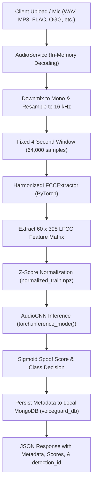

# VoiceGuard – Local AI Voice Spoof Detection Backend

FastAPI backend providing local, private, and real-time inference to detect whether a voice recording is human-generated (**BONAFIDE**) or synthetic / AI-generated (**SPOOF**), integrated with local MongoDB Community Server for persistent detection telemetry and history.

---

## 1. Architecture & Local Pipeline Overview

The backend is 100% self-contained and executes on local hardware (CPU/GPU) with zero cloud services or external API dependencies.



### Key Technical Properties:
* **Audio Window:** 4.0 seconds (64,000 samples at 16,000 Hz).
* **Feature Extractor:** 60-band Linear Frequency Cepstral Coefficients (LFCC) over 398 time frames.
* **Model:** 3-block convolutional neural network (`AudioCNN`, 24,305 parameters, ~97.4 KB) loaded once at startup.
* **Storage Engine:** Local MongoDB Community Server (`mongodb://127.0.0.1:27017`), database `voiceguard_db`, collection `detection_history`.
* **Zero Audio Persistence:** Only acoustic metadata and diagnostic metrics are stored in MongoDB. Raw waveforms, audio bytes, and LFCC feature matrices are NEVER persisted.
* **Graceful Degradation:** If MongoDB is offline, audio classification continues seamlessly with HTTP 200, setting `db_saved: false` and a diagnostic warning.

---

## 2. Directory Structure

```
backend/
├── main.py                     # FastAPI app, lifespan initialization, CORS, and routing
├── config.py                   # Global configuration (paths, thresholds, MongoDB settings)
├── schemas.py                  # Pydantic data models for validation and responses
├── audio_service.py            # In-memory audio validation, decoding, downmixing, and resampling
├── model_loader.py             # Thread-safe singleton loader for CNN checkpoint and normalizer
├── inference.py                # End-to-end inference under torch.inference_mode()
├── database/
│   ├── __init__.py
│   ├── connection.py           # Singleton PyMongo connection manager with health ping & indexes
│   └── detection_repository.py # CRUD operations for detection history, pagination, and stats
├── routes/
│   ├── __init__.py
│   └── history.py              # API routes for history listing, detail, delete, and DB health
├── requirements.txt            # Python package requirements
├── README.md                   # Backend documentation and quickstart guide
└── tests/
    ├── __init__.py
    ├── test_backend.py         # End-to-end endpoint tests
    └── test_database_offline_resilience.py # Failover and offline DB resiliency tests
```

---

## 3. Installation & Prerequisites

Ensure Python 3.10+ and MongoDB Community Server are installed locally:

```powershell
# Navigate to project root
cd "<path-to-project-root>"

# Install backend dependencies
pip install -r backend/requirements.txt
```

---

## 4. Starting Local Services

### Step A: Start Local MongoDB Server
Ensure MongoDB daemon is running locally on port 27017:
```powershell
# Using default service or standalone mongod
mongod --dbpath <data_directory> --port 27017 --bind_ip 127.0.0.1
```

### Step B: Start FastAPI Backend
```powershell
python -m uvicorn backend.main:app --host 127.0.0.1 --port 8000 --reload
```

Startup log confirmation:
```text
INFO:     Started server process
2026-11-15 17:33:19 [INFO] backend.model_loader: AudioCNN checkpoint loaded successfully from 'best_audio_cnn.pth'
2026-11-15 17:33:19 [INFO] backend.model_loader: HarmonizedLFCCExtractor initialized on device: cpu
2026-11-15 17:33:19 [INFO] voiceguard.database: Successfully initialized MongoDB indexes on collection 'detection_history'
2026-11-15 17:33:19 [INFO] voiceguard: Local MongoDB connected at mongodb://127.0.0.1:27017
INFO:     Application startup complete.
INFO:     Uvicorn running on http://127.0.0.1:8000
```

---

## 5. API Endpoints Reference

### Diagnostics & Core Prediction
| Endpoint | Method | Description |
|---|---|---|
| `/api/health` | GET | Check backend server status, uptime, and loaded model |
| `/api/model-info` | GET | Retrieve CNN architecture, LFCC filter count, and input shapes |
| `/api/predict` | POST | Classify uploaded audio, returning score, class, and auto-saving to MongoDB |

### Local Database & Detection History
| Endpoint | Method | Description |
|---|---|---|
| `/api/database/health` | GET | Local MongoDB connectivity status, database name, and ping latency in ms |
| `/api/history` | GET | Paginated list of detections with filtering (`class_filter=BONAFIDE` or `SPOOF`) |
| `/api/history/{id}` | GET | Retrieve single detection record with complete acoustic and model metadata |
| `/api/history/{id}` | DELETE | Delete single detection record by its unique ID |
| `/api/history` | DELETE | Clear all detection history from MongoDB collection |

---

## 6. Running Automated Tests

```powershell
# 1. Run core backend unit tests
python -m pytest backend/tests/test_backend.py -v

# 2. Run offline MongoDB resilience tests
python -m unittest backend/tests/test_database_offline_resilience.py

# 3. Run complete integration suite
node frontend/scripts/test_phase4_integration.mjs

# 4. Run real browser Chrome CDP audit
node frontend/scripts/test_phase4_browser.mjs
```

---

## 7. Privacy & Security Note

All uploaded audio data is decoded and analyzed strictly in temporary system RAM (`io.BytesIO`) and discarded immediately after prediction. Only lightweight diagnostic metadata (duration, sample rate, confidence, timestamps, and model parameters) is saved to the local database. Zero audio bytes, raw waveforms, or feature tensors are ever saved.
